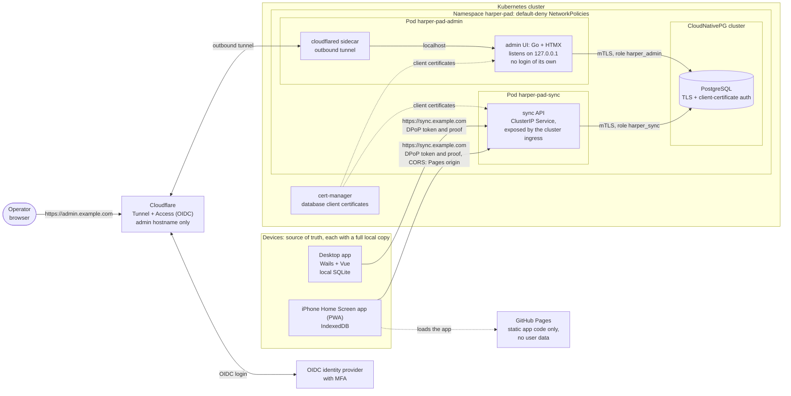

# Backend

The optional sync service for Harper Pad: `harper-pad-sync` (the API) and `harper-pad-admin` (Go + HTMX, for enrollment URLs
and devices), on PostgreSQL. The design is in [`docs/sync.md`](../docs/sync.md). It offers the health endpoints, the admin
pages, the schema migrations, device enrollment (`POST /enroll`) and the draft routes (`GET /docs`, `GET` and `PUT /docs/<id>`) and the settings routes (`GET` and `PUT /settings/<key>`).

This is its own Go module (`github.com/cthtrifork/harper-pad/backend`) and shares no code with the desktop app. The Kubernetes
manifests are not kept in this repository.

## Overview



| Component | Runs as | Reachable from | Does |
|---|---|---|---|
| [`harper-pad-sync`](cmd/harper-pad-sync/README.md) | Deployment, ClusterIP Service | The cluster's ingress only | The device API: enroll, draft routes |
| [`harper-pad-admin`](cmd/harper-pad-admin/README.md) | Deployment with a `cloudflared` sidecar | The admin hostname through Cloudflare Access | Enrollment URLs, devices, schema migrations |
| PostgreSQL | CloudNativePG `Cluster` | Sync and admin pods only | All server state; TLS and client certificates, no passwords |

Two database roles: `harper_admin` owns the tables and applies the migrations; `harper_sync` has rows only. The devices stay the
source of truth, so a lost server is rebuilt by re-enrolling them and running Sync all. The Kubernetes manifests live in the
cluster's GitOps repository; run one sync replica.

| Path | What |
|---|---|
| `cmd/harper-pad-sync`, `cmd/harper-pad-admin` | The two commands |
| `internal/admin` | The admin UI (Go `html/template` + vendored htmx 2, embedded; one page: add a device, pending URLs, devices; no inline script or style, same-origin and CSRF checks). The CSS is one file per concern in `web/static` (`tokens`, `base`, `controls`, `list`, `card`, `motion`, `phone`, linked in that order from `layout.html`; `phone.css` last because it overrides). It reaches the database only through the `Store` interface, implemented on PostgreSQL by `store.Admin` |
| `internal/` | `server` (health endpoints, graceful shutdown), `config` (environment), `store` (the pgx pool, the migration runner, the admin queries in `admin.go`, the sync queries in `sync.go`, and `migrations/` with the schema from `docs/sync.md`), `auth` (device tokens, and the DPoP proof check done by [go-dpop](https://github.com/AxisCommunications/go-dpop) with a [ttlcache](https://github.com/jellydator/ttlcache) for replays; `authtest` makes proofs the way the web client does), `syncapi` (the routes on [Huma](https://huma.rocks), which serves them on the standard library's mux and describes them in OpenAPI; the CORS allowlist and the device authentication), `admin`, and `metrics` |
| `Containerfile.sync`, `Containerfile.admin` | Container images; the build context is this directory |
| `test/e2e/` | The end-to-end stack (`compose.yaml`, `Caddyfile`, `certs.sh`) and the Playwright test |

## Running in Kubernetes

Both commands run as `harper-pad-sync serve` / `harper-pad-admin serve` and are configured by environment only.

| Variable | |
|---|---|
| `LISTEN_ADDR` | Default `:9000` (sync) and `127.0.0.1:9001` (admin, loopback: only its cloudflared sidecar reaches it) |
| `PUBLIC_URL` | Sync only, required, must be `https:` or the service refuses to start |
| `SYNC_PUBLIC_URL` | Admin only, required, `https:`: the sync service's public address, which enrollment URLs (`<it>/join#<token>`) are built from |
| `CORS_ALLOWED_ORIGINS` | Sync only. Comma-separated exact origins (`https://app.example.org`, no trailing slash, never `*`) that browsers may call the API from: the Pages site and the desktop app's webview. Empty allows none. An origin that is not listed is logged once as `CORS: origin is not in CORS_ALLOWED_ORIGINS`, which is how a new client's real origin is found |
| `METRICS_ADDR` | Where `/metrics`, `/healthz` and `/readyz` are served, on their own listener so none of them is on the public route. Default `:9102` (sync); admin has none unless set, because its pod accepts no traffic except from its own sidecar. When empty, the probes are served on `LISTEN_ADDR` instead (and metrics are off) |
| `DATABASE_URL` | Optional. When unset, the standard libpq variables (`PGHOST`, `PGPORT`, `PGDATABASE`, `PGUSER`, `PGSSLMODE`, `PGSSLROOTCERT`, `PGSSLCERT`, `PGSSLKEY`) are read, which is how the cluster does client-certificate login |

| Endpoint | Use it for | |
|---|---|---|
| `POST /enroll` | Enrolling a device | `{invite, deviceName}` with a `DPoP` proof signed by the new key. Spends the invite and returns `{deviceToken, token_type: "DPoP"}`. A wrong, spent or expired invite, a bad or replayed proof and a missing proof are all the same `401` (an `application/problem+json` body that says only `unauthorized`); `400` for a malformed body, `422` for an invalid name, `413` above 4 KiB. The proof is checked before the body is read |
| `GET :9102/healthz` | `livenessProbe` | The process is serving. Never touches PostgreSQL, so a database outage does not restart healthy pods |
| `GET :9102/readyz` | `readinessProbe` | A PostgreSQL round trip succeeds (2 s limit, so set `timeoutSeconds: 3`; the result is cached for 2 s and logged only when it changes). 503 while the database is unreachable and while shutting down |

Metrics (Prometheus, `client_golang`, a private registry): `GET :9102/metrics` has the Go runtime and process collectors,
`harper_pad_http_requests_total` and `harper_pad_http_request_duration_seconds` labelled by method and route *pattern* (never the
raw path, so the label values are bounded) and `harper_pad_db_pool_*` from the pgx pool (connections by state, acquires, empty
acquires and wait time: a pool that is too small shows there before `/readyz` fails).
The sync service adds `harper_pad_auth_failures_total{reason}` (the cause behind the one 401 clients see: `missing_credentials`,
`invalid_proof`, `unknown_token`, `key_mismatch`), `harper_pad_enrollments_total{outcome}`, `harper_pad_doc_writes_total{outcome}`
(`ok`, `deleted`, `conflict`, `too_large`, `invalid`, `error`), `harper_pad_cors_rejected_total` and
`harper_pad_last_doc_write_timestamp_seconds` (per process, 0 until the first accepted write). Label values are fixed sets. The cluster needs a NetworkPolicy that lets
Prometheus and the kubelet reach port 9102 and a PodMonitor; both live in the gitops repository. The probes point at port 9102, not at the
public port, which no longer answers `/healthz` or `/readyz` (404).

**Migrations.** `harper-pad-admin` applies the files in `internal/store/migrations/` at start, in name order, each in a transaction
with its row in `schema_migrations`, under a PostgreSQL advisory lock so two pods never race. It connects as `harper_admin`, the owner
of the database and the tables (the cluster creates both roles and the owner); the files create the tables and grant `harper_sync` its
row-level rights, and `harper_sync` has no DDL. The schema is `0001_init.sql` plus `0002_settings.sql` (the synced dictionary and ignore list, with the same row security as `docs`). `docs` has row security forced with a policy for `harper_sync` only, so the admin role sees no note in ordinary SQL (the owner can still switch it off). While they run (and while the database is down) the admin's
`/readyz` is 503 and the start is retried every 2 to 30 s; `/healthz` stays 200. `harper-pad-sync` applies nothing: its `/readyz` is 503
until every embedded migration is recorded in `schema_migrations`, so it never serves a database without its tables or grants. The two
are versioned together; a new sync image waits for the matching admin.

PostgreSQL does not have to be up at start: the pool connects lazily, `/readyz` reports 503 until it is, and the pod recovers by
itself. On SIGTERM `/readyz` turns 503, the process waits 5 s for Traefik and the endpoints to notice, drains in-flight requests
(up to 20 s) and exits 0, so the default `terminationGracePeriodSeconds` of 30 is enough (5 + 20 = 25). The driver is
[pgx v5](https://github.com/jackc/pgx), the most widely used maintained PostgreSQL driver for Go.

```sh
make help    # list the targets
make build   # build both commands into ./bin
make test    # go test ./... (the tests that use PostgreSQL are skipped without the stack, see make test-db)
make test-db # the same, with PostgreSQL from the e2e stack, so the store tests run
make e2e     # build the web app, start the stack, run the test, remove the stack
```

`make e2e` needs Node 22+, Playwright (`PLAYWRIGHT_DIR`, a global `playwright-core`, or `E2E_BROWSER_PATH` for a Chromium binary) and
`podman compose` or `docker compose`. The stack serves the web build at `https://app.localhost:18443` and the sync service at
`https://sync.localhost:18443` (set `E2E_PORT` to use another host port) with certificates from Caddy's own CA; Chromium is started trusting only Caddy's CA (its intermediate's key, via `--ignore-certificate-errors-spki-list`), so certificate errors are not ignored.

PostgreSQL in the stack runs the production login: TLS required, and a client certificate whose common name is the role, no password.
`certs.sh` makes a throwaway ECDSA CA and the certificates inside the postgres container, PostgreSQL requires TLS 1.3, `harper-pad-sync` connects with the libpq
variables (`PGSSLMODE=verify-full`, `PGSSLROOTCERT`, `PGSSLCERT`, `PGSSLKEY`), and the test checks that TLS without a certificate,
a certificate with another common name and a plain connection are all refused. What it still does not check is cert-manager issuing
and renewing, and the NetworkPolicy.

`podman compose` is only a front end: it needs a provider, `podman-compose` (`pip install --user podman-compose`) or
`docker-compose`. The stack has been run with podman 5.8 and podman-compose 1.6; `docker compose` has not been tried.

## Trying the admin UI

The admin pages run on PostgreSQL, and the end-to-end stack already has one with the production login (TLS 1.3, client certificate,
no password): the admin container connects as `harper_admin` with its own certificate. That role owns the database and the tables
and applies `internal/store/migrations/*.sql` when the admin starts; the stack only creates the two roles and the database owner
(`test/e2e/initdb`, which the cluster does in production). `harper-pad-sync` logs in as `harper_sync`, which has rows only, so the
grants the tests check are the ones production has (the bootstrap superuser is never used by a service).

```sh
make admin-up     # PostgreSQL, harper-pad-sync (applies the schema) and the admin UI: http://127.0.0.1:19001
make admin-seed   # three devices (testdata/admin-seed.sql); run it again for more
make admin-down   # stop and delete the data
```

Ports are `E2E_ADMIN_PORT` (default 19001) and `E2E_PG_PORT` (PostgreSQL on loopback, default 15432). To run the admin from source
against the same stack, copy the certificates out with `make e2e-certs` and set the libpq variables the cluster uses
(`PGHOST=localhost PGPORT=15432 PGDATABASE=harper PGUSER=harper_admin PGSSLMODE=verify-full PGSSLROOTCERT=.e2e-certs/ca.crt
PGSSLCERT=.e2e-certs/admin.crt PGSSLKEY=.e2e-certs/admin.key SYNC_PUBLIC_URL=https://sync.example.test`).

## OpenAPI

The routes are described in [`../docs/openapi.yaml`](../docs/openapi.yaml), **generated from the Go request and response types** (the field
tags carry the constraints and descriptions), not written beside the code. `make openapi` rewrites it; rerun it when a route or field changes. Huma also serves it:
the documentation page at `/api`, the document at `/openapi.json` and `/openapi.yaml`. They are public like `/healthz`, need no proof and describe only
the routes. The page is not at Huma's default `/docs`, which is the draft list; there are no schema routes and no `$schema` member in bodies.
The page loads its viewer (Scalar, pinned with an integrity hash; it collapses its sidebar on a phone) from unpkg.com, so it needs the browser to reach that host, and its fonts come from fonts.scalar.com.
The DPoP header and the device token are described but not marked `required` in the schema, because a missing credential must be the same
401 as a wrong one, not the 422 Huma gives a missing required header: the middleware that checks them runs before Huma validates the input.

## Tests

`make test` runs the tests that need no database. The handler tests (admin and sync API) and the store tests all run on the stack's
PostgreSQL, with no in-memory copy of the store, and are **skipped** unless `TEST_PG_CERTS` points at the stack's certificates; only a
small stub that fails on demand stands in for the store, for the paths that must hide a database error. `make test-db` does everything: it starts the stack's PostgreSQL, copies the
certificates to `.e2e-certs/`, runs `go test -race ./...` and removes the stack. The store tests log in the way the services do
(libpq variables, `verify-full`, client certificate): as `harper_admin`, the owner, which applies the migrations and seeds and checks
rows, and as `harper_sync` for the sync store, which runs under its real, row-level grants. They check the queries, that a certificate
with another common name and a plain connection are refused, that `harper_sync` gets a permission error on DDL, on deleting, on
`clients` and on everything beyond its grants, that the admin role sees and can write no note (row security), and that the schema is reported current only when every migration is recorded. CI runs
`make test-db`; the packages run one at a time (`-p 1`) because they share the database.

## Security scan

`.github/workflows/backend-zap.yml` runs the OWASP ZAP full scan (spider, passive and active rules) against `harper-pad-sync` in the
end-to-end stack on every change under `backend/` and weekly. `test/zap/rules.tsv` marks the OWASP Top 10 classes the service
controls itself (injection, path traversal and file inclusion, SSRF, error disclosure, missing security headers) as FAIL; other
findings do not fail the job. Every alert is an annotation on the run (an error for FAIL rules, a warning otherwise), a table in the job summary, a SARIF upload to code scanning (`test/zap/sarif.sh`; the Security tab tracks each rule and URL until a run stops finding it) and, on pull requests from this repository, one comment that each run updates (`test/zap/report.sh`); the full reports are the `zap-report` artifact. Locally: `make e2e-up`, then run
`zap-full-scan.py -t http://sync:8080 -c rules/rules.tsv` from the ZAP image on the `harper-pad-e2e_default` network, with
`test/zap` mounted at `/zap/wrk/rules`. A scanner cannot see logic flaws in the sync protocol, so this complements the protocol tests
and does not replace them.

## Images

`.github/workflows/backend-image.yml` builds both Containerfiles on every change under `backend/` (and weekly), scans the image
with Trivy (a CRITICAL finding with a fix fails; HIGH ones are listed in the job summary) and starts it to check `/healthz`.
Nothing is published from there. `release.yml` publishes `ghcr.io/cthtrifork/harper-pad-sync` and `harper-pad-admin` for
`linux/amd64` when a version is cut ("Tag and release", see [releasing](../docs/releasing.md)), tagged `1.2.3`, `v1.2.3`
and, for a final release, `latest`, with SBOM and provenance attestations; the job summary lists each image's digest, which is what the
cluster pins. The packages
are private by default (Settings, or the package page, to make them public; otherwise the cluster needs an `imagePullSecret`).
