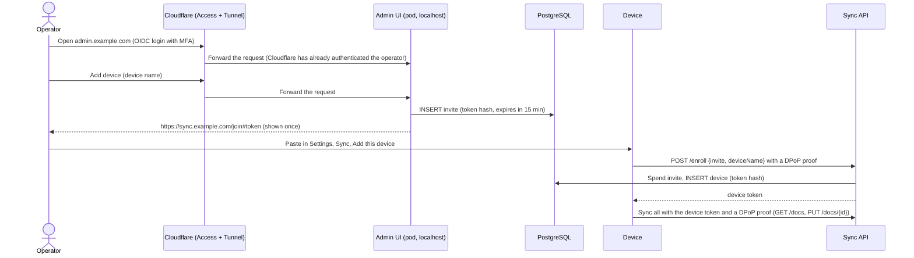

# harper-pad-admin

A small Go + HTMX server for the operator: it creates enrollment URLs and manages devices, and it owns the database schema (design:
[`docs/sync.md`](../../../docs/sync.md)). Settings and how to run it locally (`make admin-up`) are in the [backend README](../../README.md).

## What it does

One page, no navigation, usable at phone width: a name field with **Add device** (the enrollment URL is shown once, with Copy and a
countdown), the pending URLs with Cancel, and the devices with Rename and Revoke. It has no feature that reads or writes notes.
At start it applies the migrations in `internal/store/migrations/` as `harper_admin`, the owner of the database and tables, and
grants `harper_sync` its row-level rights.

## Access

The app has **no login and no idea who is using it**; Cloudflare does the authentication.

- It listens on 127.0.0.1 in a pod with no Service. Its `cloudflared` sidecar makes an outbound Cloudflare Tunnel, and a Cloudflare
  Access application with OIDC login and MFA (policy: only the operator) sits in front. The sync API is not behind Cloudflare.
- In the app: a same-origin check and a CSRF token on every state-changing request, and the same strict CSP as the web app.
- Cloudflare terminates TLS for the admin hostname, so it can see the enrollment URL (single use, 15 minutes). The Access policy is
  the whole access control: treat the Cloudflare account and the policy as part of the security of the notes.
- Admin access means being able to enroll a device, and in v1 a device can read every note. Row security on `docs` hides the notes
  from the admin role in ordinary SQL, but as owner it could switch that off.

## Enrolling a device

Paste the URL inside the installed app: a tapped link would open Safari, which has its own storage on iPhone. v1 has one client
account, so there is no account selector.
