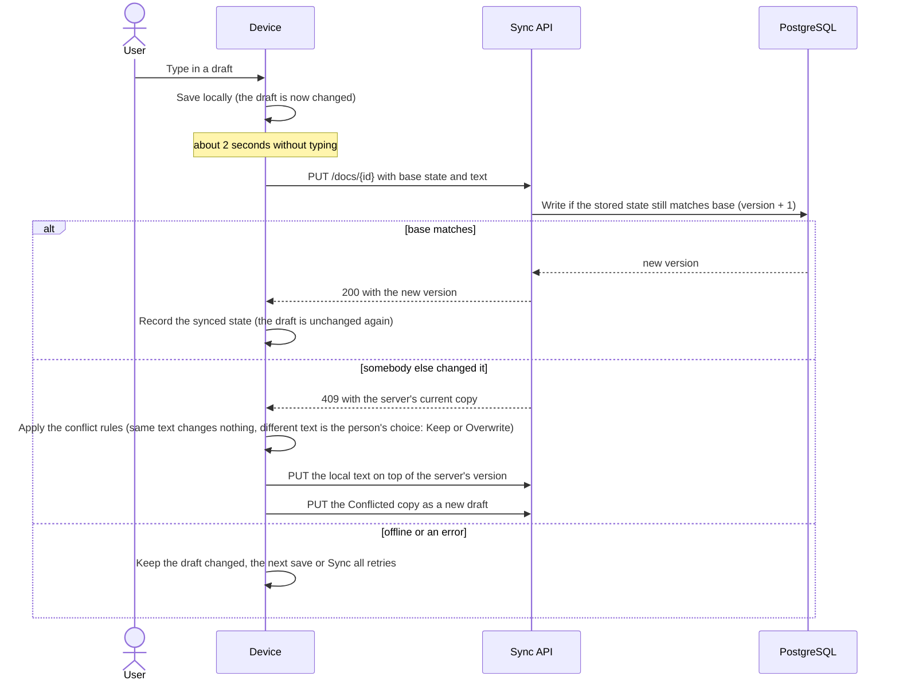

# harper-pad-sync

The public sync API of Harper Pad: plain storage with compare-and-set. It assigns each draft a version and never merges, copies or
orders anything across drafts; all sync logic lives on the device (design: [`docs/sync.md`](../../../docs/sync.md)).
Settings, health checks and tests are in the [backend README](../../README.md).

## What it does

| Route | Purpose |
|---|---|
| `POST /enroll` | Spends an invite and returns a device token bound to the device's DPoP key |
| `GET /docs` | The state of every draft (no text), paged |
| `GET /docs/<id>` | One draft with its text; `ETag` and `If-None-Match` |
| `PUT /docs/<id>` | Write if the stored state matches `base`, otherwise `409` with the server's current copy; a delete is a tombstone |
| `GET /settings` | The synced dictionary and ignore list (two lists) with its `version`; 404 until stored |
| `PUT /settings` | Write if the stored `version` equals `baseVersion` (0 for none), otherwise `409` with the current copy. The server checks the shape and never merges: the last device to write wins ([`docs/sync.md`](../../../docs/sync.md#dictionary-and-ignore-list)) |
| `:9102/healthz`, `:9102/readyz`, `:9102/metrics` | Probes and Prometheus metrics, on a port that is not routed publicly |

The routes are described in [`docs/openapi.yaml`](../../../docs/openapi.yaml), generated from the Go types.

## How it works

- **Device token plus DPoP.** Every route except `/enroll` needs `Authorization: DPoP <token>` and a signed `DPoP` proof from the
  device's key ([RFC 9449](https://rfc-editor.org/rfc/rfc9449)); `/enroll` takes the proof alone. The server stores only the token's
  SHA-256 and the key's thumbprint, so a token copied without its key is useless. The proof is checked before the body is read.
- **The account comes from the token,** never from the request; every query filters on it.
- **One generic 401** for every credential failure, whatever the cause.
- **Rows only.** It logs in to PostgreSQL as `harper_sync` (client certificate, no password): no DDL, no deletes. `/readyz` is 503
  until `harper-pad-admin` has applied the migrations.
- **Draft limits:** valid UTF-8, a known format, a strict id, at most 1 MiB in the app and 2 MiB in the database.
- **Run one replica:** the DPoP replay cache is per pod. Only the cluster's ingress may reach it, because the client IP comes from
  `X-Forwarded-For`. CORS allows exactly the configured origins.

Saving a draft:

Tombstones keep no text and are kept forever. Conflicts are settled on the device
([`docs/sync.md`](../../../docs/sync.md#the-keep-or-overwrite-dialog)).
