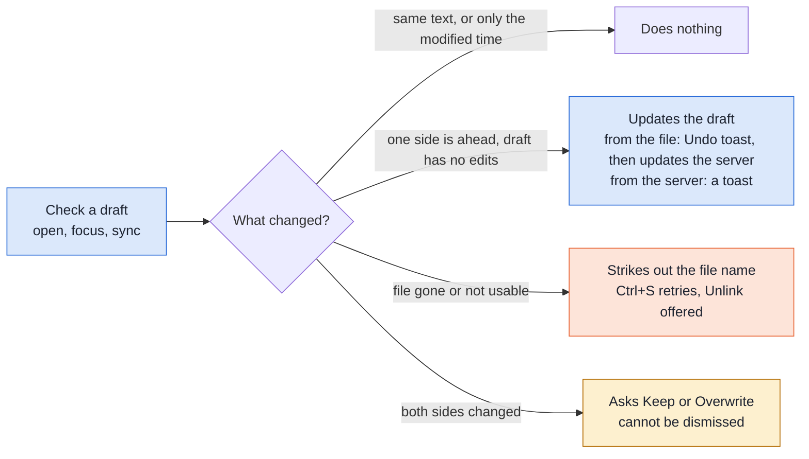
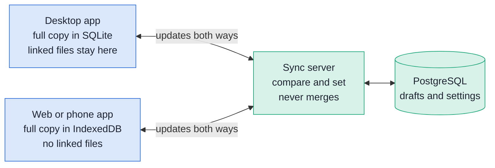
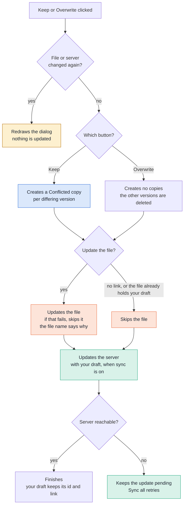
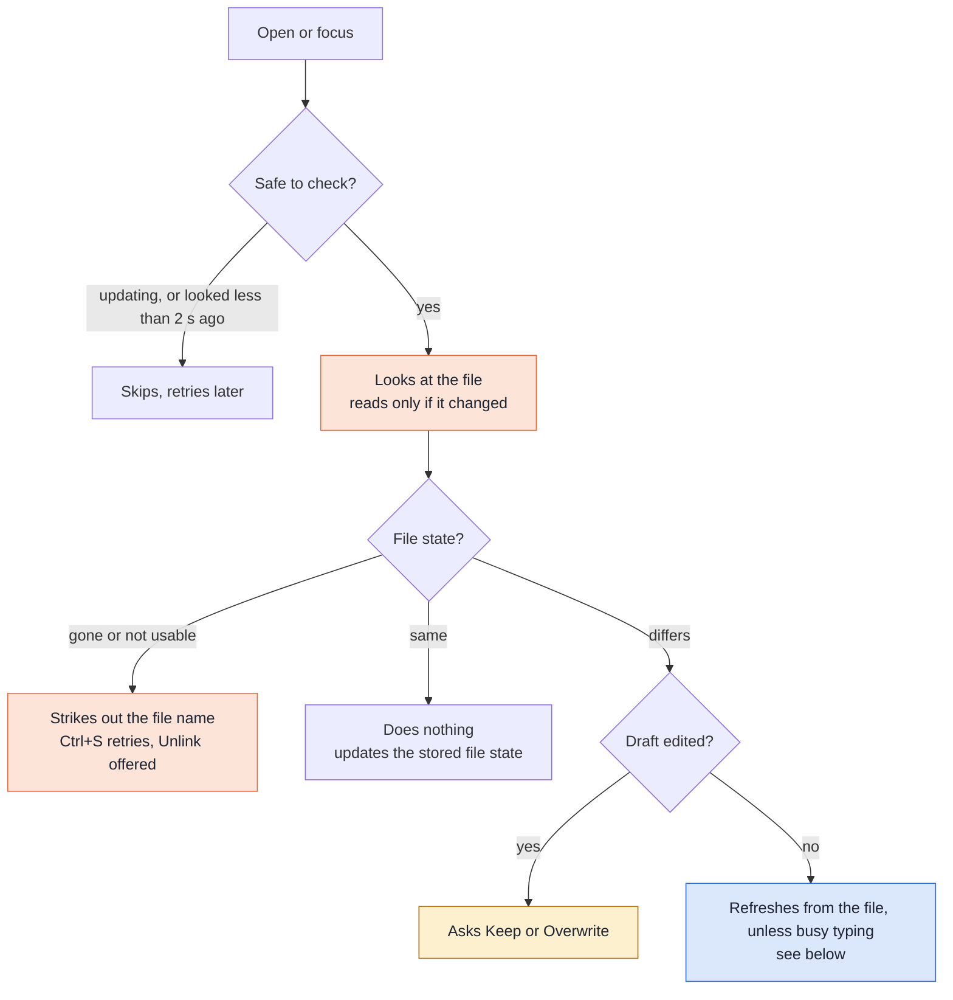
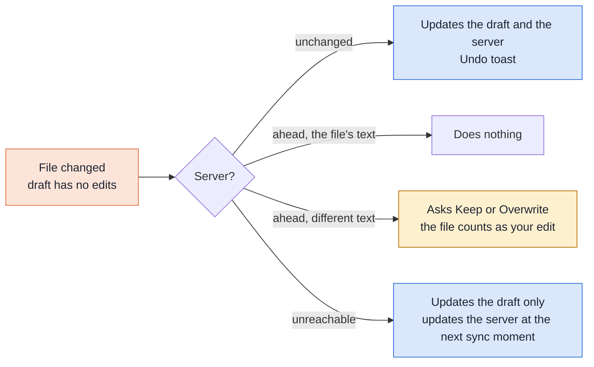
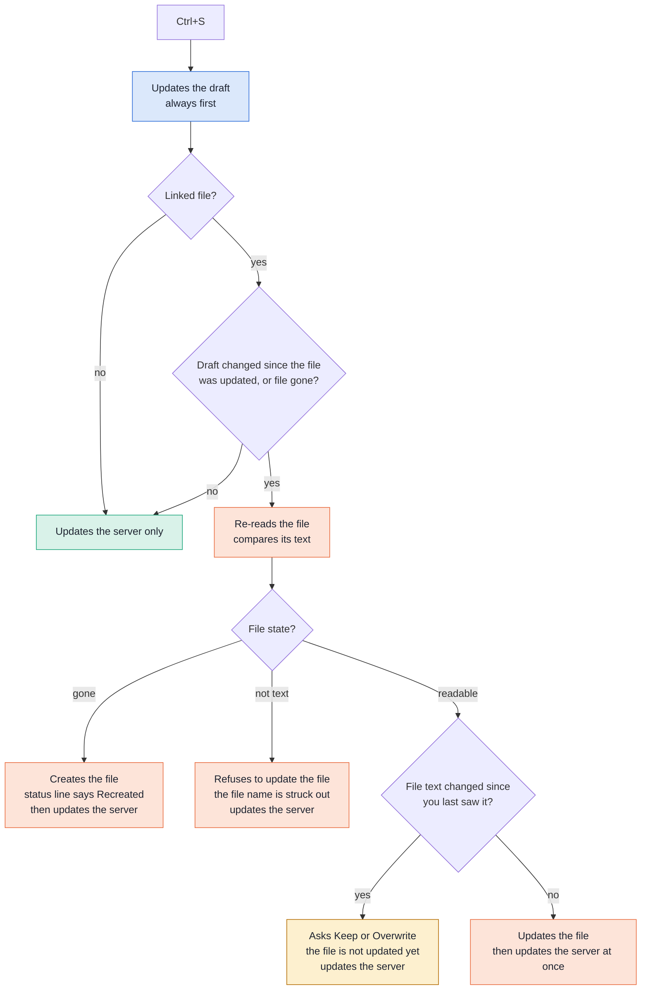
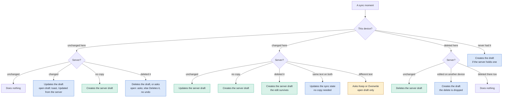
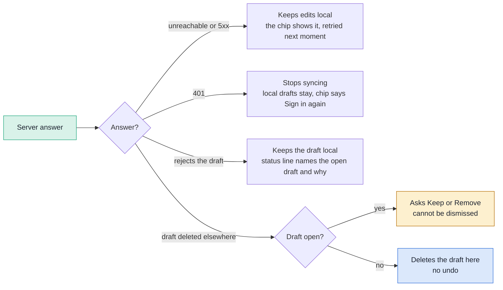

# Sync

Sync keeps your drafts, your personal dictionary and your ignore list the same on the desktop app and the web app (the iPhone Home Screen app is the web build). Each device holds all
its drafts and works without the server. The server is plain storage with compare-and-set: it never merges and never makes copies.
Sync is off until you enroll a device; without it the app uses the network only to check for an app update.

When your draft differs from another version of it, the app asks one question, in one dialog: **Keep or Overwrite**. Protected drafts use the
same flow after unlocking, with encrypted copies ([below](#a-protected-drafts-conflict)).

Blue is the app, orange the file, green the server, amber a question for you.

The server is described next to its code: [backend README](../backend/README.md), [sync API](../backend/cmd/harper-pad-sync/README.md),
[admin UI](../backend/cmd/harper-pad-admin/README.md), routes in [openapi.yaml](openapi.yaml).

### Where the decisions are made

Every decision, conflicts included, is made on the device. The file path and the file's modified time never leave it.

## Rules

- The device is the source of truth. The server is a replica.
- A draft the server lacks is Created there. Only an explicit delete Deletes a draft.
- Sync never changes the open draft while you type, and never decides a conflict.
- Revoking a device, an invalid token, a server reset and turning off sync on this device leave the drafts on the device.
- The device key is made on the device and never leaves it.

## What needs you

| Situation | What appears | Your choices |
|---|---|---|
| Your draft is edited and its file changed | The Keep or Overwrite dialog | Keep, Overwrite |
| Your draft is edited and the server holds different text | The same dialog | Keep, Overwrite |
| Your draft is unedited, and the file and the server disagree | The same dialog; the changed file counts as your edit | Keep, Overwrite |
| A protected draft was changed on both sides | The same dialog after unlocking, with no text in it | Keep both, Overwrite server |
| The open draft was deleted on another device | A dialog | Keep Creates the server draft again; Remove Deletes the draft here (the toast offers Undo) |
| The linked file is gone, unreadable or not text | The file name in the header is struck through; its tooltip gives the full path and the reason | Ctrl+S retries; the unlink button on the file name Deletes the link; unlink first to pick another path with Save to disk. A file that is not text is never updated |
| The token was revoked | The chip says "Sign in again" | Paste a fresh invite |
| Enrolling | The Sync chip | Paste the invite URL |

## The Keep or Overwrite dialog

- It has no close button; Escape and a click outside do nothing. The editor is blocked; autosave keeps updating the draft behind it.
- It appears only for the open draft. A draft in conflict that is not open is left untouched (not Created, Updated or counted) until it is opened.
- One dialog covers the file and the server when both differ.
- Closing the window while it is open is allowed. The dialog returns the next time the draft is opened.
- Your draft keeps its id and its file link.
- The dialog is a title, one row per version that exists (your draft, the file, the server) with its timestamp, two buttons and one footer line, "Overwrite cannot be undone." A long file name is cut so the timestamp always shows.
- **Overwrite file** or **Overwrite server**, whichever other version there is (**Overwrite others** with three versions) Updates the file, then the server, with your draft. The other versions are Deleted, with no undo. Keep and Overwrite skip the check that the file changed on disk (the dialog just made it) but never Update a file that is not text. Its button is the danger style and its tooltip says the other versions are Deleted. When your draft has no edits of its own, the file counts as yours (the footer says so) and only the server is Updated.
- **Keep** (**Keep all** with three versions) first Creates a Conflicted copy of each other version that differs from your draft (one copy when the file and the server hold the same text), then does what Overwrite does.
- A Conflicted copy is an ordinary draft without a file link, with a badge in memory ("Conflicted copy, from the file", "from the server" or "from the file and the server"). The badge goes when the copy is edited or deleted, from its x, or at restart. It is never kept on disk or synced, and the text is not edited.
- Keep has the focus. The dialog looks the same on a phone: centered, with the two buttons stacked, Overwrite above Keep.

## Other paths on this device

### Open or focus

### Refresh from a changed file

### Ctrl+S

### Everything else

| Path | What happens |
|---|---|
| Edit your draft | Autosave Updates the draft, never the file. Ctrl+S Updates the file when the draft changed since the file was Updated |
| Undo of that update, then Ctrl+S | Your draft wins while the file is still the version the update read; otherwise the dialog |
| The draft is Updated from the file | The cursor and scroll position stay as far as the text allows, and autocorrect leaves the text alone |
| The server holds a changed draft | It Updates your draft. The file counts as older than the draft; the next Ctrl+S Updates it, after the dialog if the file also changed |
| Delete a linked draft | The file is untouched. Undo Creates the draft again without the link |
| Sync or Save button (Ctrl+S) | Says **Sync** once sync is set up and this device is enrolled, and always has something to do: it Updates the draft, Updates its file when the draft changed, and asks the server. Says **Save** without sync: it does the first two, and is disabled while there is nothing to Update |
| Save to disk | Offered only for a draft without a link (a struck file name still counts as linked). Ctrl+Shift+S on a linked draft only shows "Unlink first to save as another file" |
| A dot beside the file name | Your draft has changes the file does not have yet; Ctrl+S or Save Updates the file and the dot goes. Never shown with a struck file name |
| The copy button on the file name | Copies the full path of the file to the clipboard; the icon turns into a check for two seconds |
| The unlink button on the file name (a broken link) | Deletes the link only; the file and your draft are untouched. A toast "Unlinked <name>" has Undo, which Creates the same link again (path and baseline); then Save to disk returns |
| Save to disk onto the path of another draft | The link moves to this draft and the other draft is unlinked, with a toast naming it |
| Web build | It never links a draft to a file; the header offers Save to disk, or Share on iPhone and iPad |

## Sync moments

Sync is never periodic. Every moment uses the same rules.

| Moment | What it does |
|---|---|
| Edit | Updates the server draft about 2 s after typing stops; Ctrl+S at once |
| Open a draft | Asks the server once; a changed server draft Updates yours unless you typed ("Updated from the server") |
| Delete | Deletes the server draft when the undo offer ends |
| Sync all | Runs at start-up and after enrolling, from the chip's pop-up too; ends with a summary like "3 uploaded, 2 downloaded, 1 removed", which also counts failed and left-open drafts |
| Dictionary and ignore list | Updates the server about 2 s after a change, and on Sync all |

A draft that changed on both sides with different text is the dialog's; Sync all leaves it untouched. Typing and then undoing is no change.

### A protected draft's conflict

A protected version is ciphertext with a new nonce on every save, so two devices that saved the same text can still hold different strings.
The syncer compares these envelopes using the ordinary rules; it has no protection-specific path. Protection is fixed at creation, so the app
never produces a plain version of an existing protected draft.

The shared Keep or Overwrite dialog waits until the draft is unlocked. It shows version times, never the text or ciphertext:

- **Keep both** opens the server envelope with the key already held, then seals it under a new draft id as a protected Conflicted copy.
  The copy retains the server title and the original passphrase. Only after saving it does the app push this device's version.
  If the server envelope cannot be opened, Keep fails without uploading or making a plaintext copy.
- **Overwrite server** pushes this device's version without making a copy. The server's other version is lost, with no undo.
- Both choices first save pending edits and recheck the versions, as for plain drafts. A changed draft or server redraws the dialog.
- A file conflict never arises, because a protected draft has no file link.

### The decision for one draft

## The file link meets sync

- Only `{v, format, content}` travels, with the draft's own times. The file path and the file's modified time stay on the device, and a draft Created from the server has no link.
- Remove in the deleted-elsewhere dialog never touches the file. Keep Creates the server draft again, and the draft keeps its file link.

## Dictionary and ignore list

These are small and are meant to be the same on every device, so there is no per-word merge: the last device to sync wins, and absence is
deletion. A device that syncs them for the first time Deletes nothing: it Creates the union of both sides.

- It runs on Sync all and about 2 s after a change. At start-up it waits for Harper.
- The labels of ignored findings are not synced; a hash from another device shows as "A finding in its context".
- If it fails, the chip's pop-up says "Could not sync the dictionary and ignore list" (see Failure states).

## Failure states

| Failure | What happens |
|---|---|
| Server unreachable | Edits stay on the device, the chip says "Offline", the next moment tries again |
| A 5xx | Edits stay on the device, the chip's pop-up says "Some drafts are not sent yet.", the next moment tries again |
| 401 | Syncing stops and the chip says "Sign in again". A lost key, such as iOS clearing a Home Screen app's storage, ends here too |
| The server rejects a draft (too large, bad request) | The draft stays and keeps updating locally; the status line says "Could not sync <title>: <reason>" for the open draft; no dialog; the next moment tries again |
| Server lost | The devices Create the server drafts again; devices and tokens need enrolling again; a draft deleted on one device while another was offline can reappear |
| Dictionary or ignore list fails | The chip's pop-up says "Could not sync the dictionary and ignore list"; the next Sync all or change tries again; the local lists are untouched |

## Limits

- A word removed on the other devices before a device enrolls comes back when that device still holds it: the first sync cannot tell "removed elsewhere" from "never had".
- Overwrite is the only choice that Deletes text, and the server keeps no history to restore it from.

## Enrollment

Every device, including the first, enrolls the same way.

1. In the admin UI the operator names the device and picks **Add device**. It shows `https://sync.example.com/join#<token>` once. The
   token is 256 random bits, single-use, valid about 15 minutes and kept only as a hash. It is in the fragment, so it is not sent or logged.
2. In the app, open the **Sync chip**, paste the URL and choose **Add this device**. (Paste rather than open the link: on iPhone a
   tapped link opens Safari, which has separate storage from the Home Screen app.)
3. The app makes a signing key pair on the device and calls `POST /enroll` with the invite and a DPoP proof. It gets a device token bound to that key.
4. The app runs Sync all.

The invite is the approval: the operator signs in through Cloudflare Access with MFA, and every device is listed and revocable in the admin UI.

## Authentication

Every request after enrollment carries `Authorization: DPoP <device token>` and a `DPoP` proof header.

- The token is 256 random bits per device, long-lived, with no refresh token. The server keeps its SHA-256; deleting the device row makes the next request a 401.
- It is a header, not a cookie, so other sites cannot make the browser send it.
- Every credential failure (bad or replayed proof, unknown or revoked token, wrong key, bad invite) is the same generic 401.

**DPoP** is [RFC 9449](https://rfc-editor.org/rfc/rfc9449) with one change: the token is opaque, so the key's RFC 7638 thumbprint is kept on
the `devices` row instead of a `cnf.jkt` claim. The key is ECDSA P-256 and proofs are ES256 JWTs bound to the request and the token. The
server checks the proof before reading the body, using [go-dpop](https://github.com/AxisCommunications/go-dpop). A 60 second `iat`
window and a replay cache of proof ids replace a `DPoP-Nonce`.

| Attacker | What helps |
|---|---|
| Copies the token (log, proxy, script) but not the key | DPoP: the token is useless without a fresh proof from the key |
| Copies the device's own storage (disk image, backup, profile) | Not DPoP: on Chromium the kept key is usable. Revoke the device and encrypt the disk |
| Uses the unlocked device or runs script in the page | Revoke, and the strict CSP ([security](security.md)). Its edits reach the other devices; the server keeps no history |

## Key storage

The web and desktop builds keep a non-extractable WebCrypto key (only the private `CryptoKey`) and the token in the webview's IndexedDB. If that storage is
cleared the key is lost and the device enrolls again. `extractable: false` stops script exporting the key; it does not encrypt it on disk
(Chromium keeps it in plain form in the profile). Checked on an iPhone (Safari tab and Home Screen app, PR #86): key generation,
private-key-only storage, refused `exportKey` and raw signatures work, and the key survived 20.6 hours. Edge on Windows passes too. WebKitGTK was not checked.

Device settings (server URL, token, key) are one record, never sent to the server. Sync state lives in its own table or store, never on
the draft rows, and is never sent; an older build ignores it. The SQLite table is additive; the IndexedDB store needs a version bump ([pages](pages.md#changing-the-schema)).

## Security

| Concern | Handling |
|---|---|
| Transport | HTTPS only (cert-manager, HSTS at the ingress). The client refuses an `http:` server |
| Who can read the data | The server and its operator, except the text of [protected drafts](#protected-drafts-end-to-end-encryption); Cloudflare is not in the sync path. Use encrypted volumes and keep bodies out of logs |
| Stolen token | Revoke the device |
| Account isolation | The account comes from the device row and every query filters on it. With one account this is a guard; narrow the row-security policy to the account before adding a second |
| Database and cluster | Client certificates only, PostgreSQL reachable only from the sync and admin pods, separate roles ([backend README](../backend/README.md)), default-deny NetworkPolicies, images pinned by digest |
| Admin UI | No Service and no listener outside its pod; reached through a Cloudflare Tunnel behind Cloudflare Access (OIDC, MFA); same-origin checks, CSRF tokens, strict CSP ([admin README](../backend/cmd/harper-pad-admin/README.md#access)) |
| Draft text from the server | Untrusted like pasted text: never run, never inserted as HTML, validated first |

Not defended: a compromised device, a compromised server (for drafts that are not protected), and traffic analysis.

## Not built

- A device list in the app: the admin page revokes devices behind a stronger login.
- Undo for what Sync all Deletes from drafts that are not open.
- A pending count or progress line on the chip.
- A server operations page: operating and backing up the server belongs to the cluster's GitOps repository.
- Scheduled token rotation with reuse detection: it is the fallback if iOS clears the key.
- More than one client account, merging text, syncing other preferences (text size), and an OS keyring or TPM.

## Protected drafts (end-to-end encryption)

A draft can be created as protected. The server and the local database then hold only ciphertext for it, and the text is readable only after the
passphrase is entered. Other drafts are unaffected. The server stores a protected draft like any other draft; it sees ids, versions, times,
the deleted flag, sizes and the fact that a draft is protected. How the text is sealed and stored is in `frontend/src/lib/protect.ts`.

### Using it

- **Making one.** A draft is protected when it is created, never later: "New draft" in the drafts list has a small menu with "New secure draft".
  It asks for a new passphrase, typed twice, and an optional title for the draft list. Each secure draft has its own passphrase; it is not
  checked against other drafts. Nothing is stored until something is typed.
- **The padlock.** Only an open protected draft shows a small padlock at the bottom. Click it to lock the draft, or to unlock a locked one.
- **Opening a protected draft.** It opens locked. Click the padlock, enter the passphrase, and the text appears. The passphrase is asked
  again each time the draft is opened.
- **Locking.** The key is kept in memory only. It is dropped when the draft is closed, when the app goes to the background, and on locking it.
  There is no idle timer. What is unsaved is saved first, and if that fails the draft stays unlocked so the text is not lost.
- **The title.** A protected draft shows "Locked draft" in the draft list, or the title it was given when it was made. That title is not
  protected: the draft list and the server show it, it does not follow the text, and it cannot be changed. Drafts without one keep "Locked draft".
- **No excerpt.** The draft list never shows an excerpt, summary or preview of a protected draft.
  Its summary has an explicit `protected` flag in SQLite and IndexedDB, derived from the stored envelope, not a marker in the excerpt.
- **Search.** Search reads the text of plain drafts. A protected draft matches on its title only, never on its stored text.
- **Protection is permanent.** A plain draft cannot be protected and a protected draft cannot be made plain. To get the text out, unlock the
  draft, copy it into a new draft and delete the protected one; to protect a plain draft, copy its text into a new secure draft. That keeps one
  rule for sync: a draft's form never changes, so a plain version of a protected draft can never be legitimate.
- **No Harper.** Harper does not check a protected draft, and autocorrect is off. No lint results are produced, and no word is added to the
  dictionary (stored and synced in plain text). The Problems panel stays empty.
- **No file link.** A protected draft cannot be linked to a file or saved to one, because a file would hold the text unprotected.
- **Size.** Sealing makes a draft about a third larger, so a protected draft holds less text than a plain one before it reaches the limit.
- **More than one device.** The server holds the ciphertext, so a protected draft syncs like any other. Each device unlocks it with that
  draft's passphrase, which is never sent anywhere, so it has to be typed on every device.
  Concurrent edits use the ordinary **Keep both** or **Overwrite server** question after unlocking
  ([the dialog](#a-protected-drafts-conflict)). Even identical text can be a conflict because each save has its own nonce.
- **No passphrase change and no recovery.** Losing a draft's passphrase loses that draft. To use a new passphrase, copy its text into a new
  secure draft with it, and delete the old.

### Cryptography

- The key comes from the passphrase and a random salt that is kept with the draft, through Argon2id, a hash made slow and memory-hungry
  on purpose. The text is sealed with AES-256-GCM. The check covers the draft id and the title, so a copy cannot be moved to
  another draft and a title cannot be changed or swapped unnoticed. A wrong passphrase, or a draft that was changed, fails the check
  built into GCM, so no check value is stored, and the two cannot be told apart.
- Local storage holds the same ciphertext as the server. The text is decrypted only in memory, and what is derived from it (lint
  results, search, undo history, autosave copies, exports) stays in memory or is skipped.

### Limits

- A copied ciphertext (stolen token, backup, database leak) can be guessed against offline for as long as the attacker likes. The passphrase
  and the cost of Argon2id are the whole defence. The salt only stops one guess from testing every draft at once; changing the salt over
  time does not help, because it is stored beside the ciphertext and the passphrase stays the same.
- The server can delete a protected draft, replace it with plain text of its own, or replay an older ciphertext of the same draft, for example
  from a backup, and the device cannot tell. It cannot read or forge one.
- A title given to a protected draft is readable by the server, so it should not give the text away. A title the server changed is only
  noticed when the draft is opened; until then the draft list shows what the server sent.
- Not covered: a compromised device while a draft is open (it sees the plaintext and the passphrase), traffic analysis, and a server that
  serves modified web app code.
