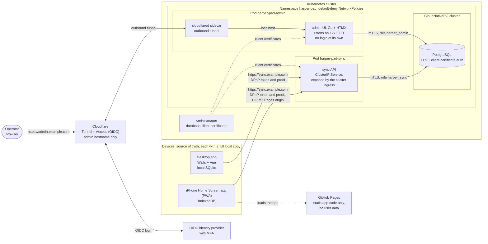
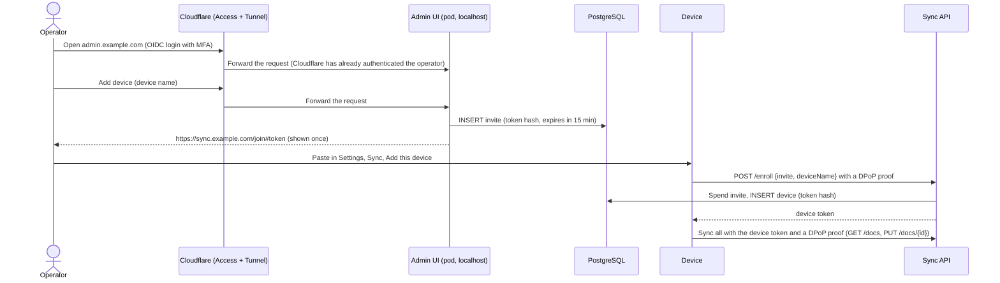
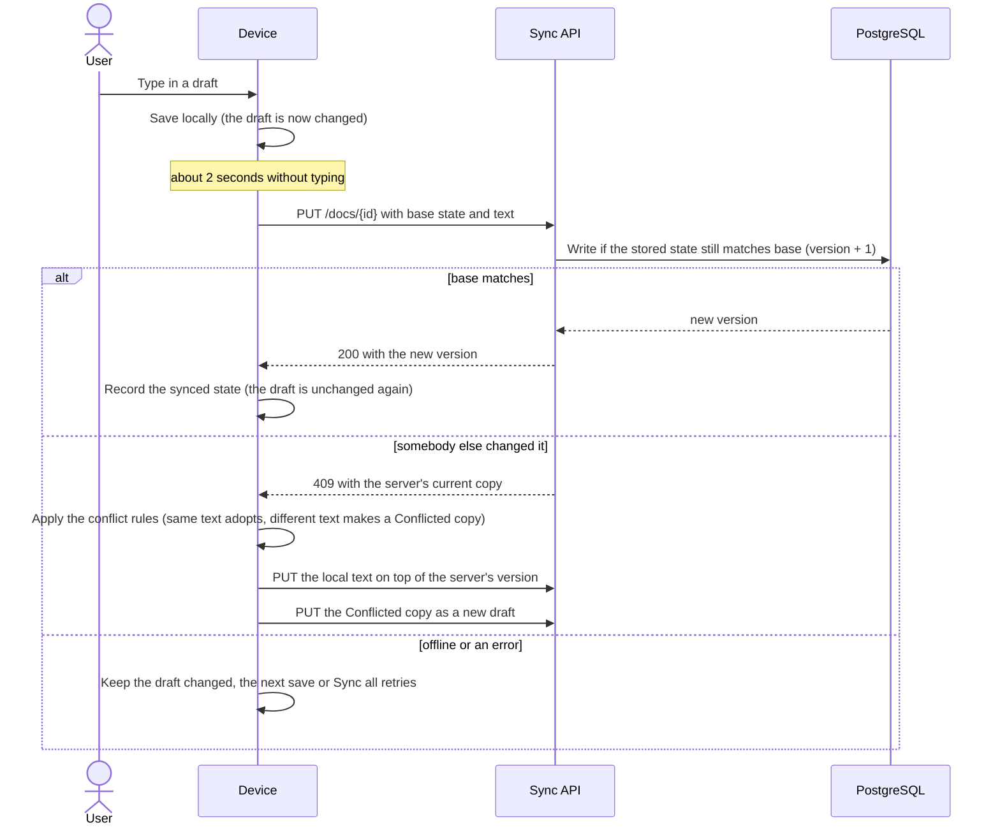
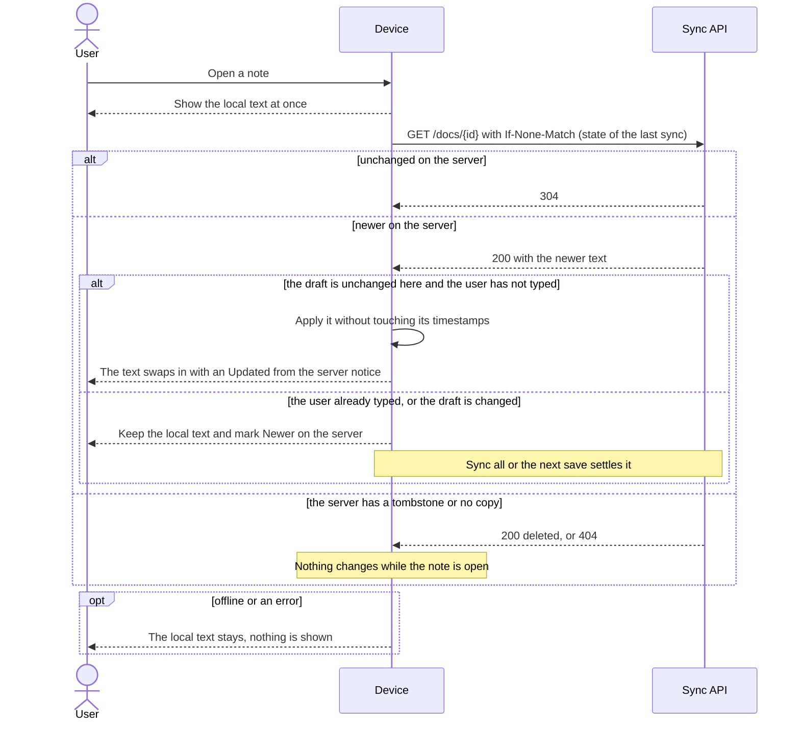
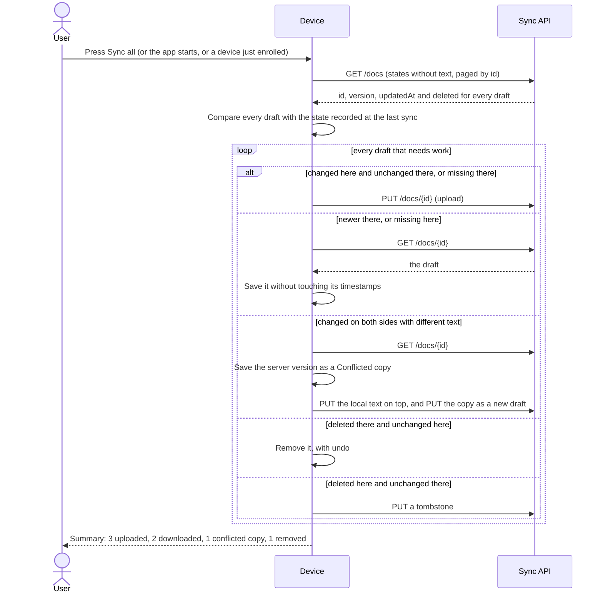

# Sync (design)

Status: **proposal, not built.** This page describes an optional sync service so **notes** (the scratch pad drafts)
follow the user between the desktop app and the iPhone Home Screen app. Nothing here is in the code yet. When it is
built, this page becomes the reference and [storage](storage.md), [security](security.md) and [architecture](architecture.md)
get the matching changes (see [Documentation changes](#documentation-changes)).

## Goals and non-goals

Goals:

- The same drafts on the desktop app and the web app (the iPhone Home Screen app is the web build).
- Works offline: editing never waits for the network, and changes made offline are sent by the next save or by **Sync all**.
- **The device is the source of truth and the server is a supporting system.** If the whole backend is lost, syncing from a device
  rebuilds it ([The client is the source of truth](#the-client-is-the-source-of-truth)).
- Off by default. A user who never turns it on has no network use beyond today's update check, and the security page's
  "no server" statement stays true for them.
- Small to run: a Go sync service, a tiny Go + HTMX admin container and PostgreSQL, on the user's own domain.

Non-goals for v1:

- **Operating-system integrations.** No OS keyring, Credential Manager, TPM or similar on any platform. The desktop app keeps its
  device key where the web build keeps its own, so the sync code is the same everywhere.
- **Syncing settings.** The personal dictionary, the ignore list, text size and every other setting stay on the device. What
  syncs is notes. Settings can be added later ([Later](#later)).
- **End-to-end encryption.** The server can read drafts. The wire format keeps the draft as an opaque string, so an encryption
  design ([Option: end-to-end encryption](#option-end-to-end-encryption)) could be added without changing how docs are pushed and
  pulled. It is an option and is not planned.
- **More than one client account in v1.** A *client account* is the owner of a set of notes and devices. Everything the server
  stores carries a `client_id` and every device is bound to one, so a second account can be added later without reshaping the
  schema, but v1 has exactly one and nothing creates another. (In this document "the client" is still the app's sync code; the
  owner is always called the client account.)
- **Real-time collaboration or merging text.** Conflicts keep both versions; they are not merged.
- **Syncing files.** A draft's link to a file on disk stays on the device.

## The client is the source of truth

The server is a relay and a replica: it is what lets a second device have the same notes. Each device holds a complete copy and is
authoritative for it. These rules apply to every part of the design below, and where something else in this page seems to
conflict with them, they win.

1. **Local first.** Every read and write uses the device's own store; sync runs behind it. The app behaves the same with sync off,
   the server down or the token revoked, and a failed sync never blocks or loses an edit.
2. **Absence is not deletion.** Only an explicit tombstone deletes a draft. A doc that is missing on the server (a new server, a
   failed write) is something to **upload**, never something to remove locally.
3. **Sync never changes what the user is working on.** A pull never overwrites a draft that has unsent edits. In a conflict the
   local text keeps its id and the other version becomes a "conflicted copy" ([Conflicts](#conflicts)), so the open editor never
   changes under the user.
4. **The server cannot destroy local data.** Revoking a device, an invalid token, a server reset and "Sign out" all
   leave the local drafts in place; sync just stops.
5. **An empty server is just a server that receives uploads.** Every device holds a full copy and **Sync all** reconciles in both
   directions, so a lost or new server is repopulated by enrolling the devices and running Sync all; nothing in the client is
   special-cased for it.
6. **What only the server holds is disposable or re-creatable.** Devices and tokens (re-enroll) and tombstones
   are the only such things.
7. **The server never generates a secret that a device must keep private.** The device's DPoP key (and, in the
   [encryption option](#option-end-to-end-encryption), the data key, the recovery key and the passphrase) is made on the device
   with its own random generator and never sent to the server. The server creates only secrets it is meant to know: invite
   tokens and device tokens, which it stores as hashes.

What losing the whole server costs:

| Lost | Effect |
|---|---|
| Drafts | Nothing: rebuilt from the devices |
| Devices and tokens | Every device shows "Sign in again". Create one enrollment URL per device in the admin UI; local data is untouched |
| Tombstones | A draft deleted on one device while another was offline can **reappear** when that other device re-uploads. Harmless and rare: delete it again |

## Decisions

| Decision | Choice | Why |
|---|---|---|
| Server | A new Go service, `harper-pad-sync`, as a Kubernetes Deployment behind a ClusterIP Service, exposed through the cluster's ingress | Small, one static binary; applies the same draft limits as the app, written separately (see Code layout) |
| Database | PostgreSQL run by the **CloudNativePG operator** in the same cluster, authenticated with **client certificates** (mTLS), no passwords | cert-manager issues and renews the certificates; the sync service and the admin UI each get their own certificate and a role, the admin one with least privilege |
| Schema owner | **`harper_admin` owns the tables and applies the migrations**; `harper_sync`, the public API's role, gets rows only (no DDL, no ownership) | The sync API faces the internet and parses unauthenticated input, so it gets the least. The admin UI is reached only through the tunnel behind Cloudflare Access with OIDC and MFA. Row security (forced, a policy for `harper_sync` only) hides the notes from the admin role in ordinary SQL; the owner can still switch it off. The cost: a compromised admin process could read notes (it could already enroll a device that does), and sync waits for admin to migrate |
| Admin | A separate tiny Go + HTMX container for enrollment URLs and device management, **reached only through a Cloudflare Tunnel behind Cloudflare Access with OIDC login** | No inbound port, and the app knows nothing about users or login (Cloudflare does all of it); keeps administration out of the public API. See [the admin UI](#the-admin-ui) for what this trusts |
| Hosting | Kubernetes. The sync API is exposed through the cluster's existing ingress on the user's own domain, with a Let's Encrypt certificate from cert-manager. Only the admin UI goes through a **Cloudflare Tunnel** (a `cloudflared` sidecar in its pod) | iOS trusts the certificate and sync traffic never passes through a third party; Cloudflare handles only the admin pages ([what this trusts](#what-this-trusts)) |
| Web build | Stays on GitHub Pages (`harper.portableinfo.cloud`) | Already deployed; sync is a different origin, so CORS and the CSP change |
| Code layout | `backend/` in this repository, as its **own Go module that shares no code with the app**; the sync client stays in the frontend | The overlap is about 30 lines of draft rules, and a shared module or a single module costs more than writing them twice. The end-to-end test runs the real client against the real server, which is what catches drift. The release workflow gains two artifacts, the sync and admin images |
| Client accounts | One in v1, modelled as many: a `clients` table, a `client_id` on every row, and every device bound to one account | More accounts later need no schema change. No sharing between accounts, no user management in v1 |
| Client | One JavaScript sync module used by both builds, on top of `backend.js` | The web build has no Go side; one implementation means one set of bugs |
| Auth | One opaque, long-lived device token per device, **bound to a device key with DPoP** (a signed proof on every request); no refresh tokens | See [Authentication](#authentication) |
| Approving new devices | None. A new device needs no confirmation from an enrolled one; the operator creates one short-lived, single-use enrollment URL per device in the admin UI, and that is the approval | The invite is single use and expires in 15 minutes, the operator signs in through Access with MFA, and every device is listed and can be revoked, with a "new device enrolled" notice on the others. Confirmation on an enrolled device would add a flow and a way to get locked out (no enrolled device left) for little extra safety. See [what this trusts](#what-this-trusts) |
| Stolen-token hardening | A device list with last-seen, revoking in the admin UI, and **DPoP**, which makes a token that leaks without its key useless but does not cover a copy of the device's own storage | See [Limiting the damage of a stolen device](#limiting-the-damage-of-a-stolen-device) |
| Encryption of content | None (TLS only). End-to-end encryption is an option, not planned | The server can read the notes; see [the option](#option-end-to-end-encryption) |
| Sync model | Per-draft sync on save, a check when a note opens, and a **Sync all** button in the drafts drawer (also run once after enrolling and when the app starts). No change feed, cursor, timer or server id | Much less to build and to get wrong; a lost or emptied server is repopulated by the same Sync all |
| Conflicts | Server-assigned versions; the local text keeps its id and the other version becomes a "conflicted copy" draft | Never loses text, no merge logic, the open editor never changes under the user |
| Source of truth | The device. The server can be rebuilt from any device | A supporting system must not be able to lose or destroy notes; see [the principles](#the-client-is-the-source-of-truth) |

## Overview



| Component | Runs as | Reachable from | Does |
|---|---|---|---|
| `harper-pad-sync` | Deployment and ClusterIP Service | The cluster's ingress only (NetworkPolicy) | The API: enroll, list, get and put drafts |
| `harper-pad-admin` | Deployment; the pod also runs a `cloudflared` sidecar | The admin hostname through Cloudflare, behind Access with OIDC login; listens on 127.0.0.1, so only the sidecar can connect | Creates enrollment URLs, lists, renames and revokes devices |
| PostgreSQL | CloudNativePG `Cluster` | Port 5432, only from the sync and admin pods (NetworkPolicy) | All server state; accepts only TLS connections with a valid client certificate |
| cert-manager | Cluster add-on | Nothing | Issues the database client certificates and the sync domain's TLS certificate |
| Cloudflare | External | The internet | Carries the admin tunnel and runs Access on the admin hostname. Not in the sync path |
| GitHub Pages | Static hosting | The internet | Serves the web app's code; holds no user data |

Each device keeps its own full copy (SQLite on desktop, IndexedDB in the browser) and works without the server. The sync module
pushes a draft when it is saved, checks the server when a note is opened, and reconciles everything on **Sync all**. The server is
plain storage with compare-and-set: it assigns a version to each draft and never merges, copies or orders anything across
drafts, so devices never compare clocks (they only test two states for equality).

### Database access

No workload has a database password. PostgreSQL requires TLS and a client certificate for every connection, and the clients
verify the server certificate (`sslmode=verify-full`). cert-manager issues one certificate per role (common name equal to the
role name, from the CA given to the cluster as `spec.certificates.clientCASecret`), `pg_hba` requires `cert` over `hostssl`, and
a NetworkPolicy lets only the sync and admin pods reach port 5432. The app reads the certificate files once at start; Stakater
Reloader restarts the pods when cert-manager renews them, so there is no reload code. This is deployed and working.

| Role | Used by | Allowed |
|---|---|---|
| `harper_admin` | `harper-pad-admin` | **Owns the database and the tables and applies the migrations at start**, including the grants to `harper_sync`. Row security on `docs` hides the notes from it (below), but as the owner it can switch that off ([decided](#decisions)) |
| `harper_sync` | `harper-pad-sync` | **Rows only: no DDL and no ownership.** `docs`: select, insert, update. `devices`: select, insert, and update of `last_seen`. `invites`: select, and update of `used_at`. `schema_migrations`: select. It cannot create, alter or drop anything, read `clients`, or delete a row. Until `harper-pad-admin` has applied the migrations, `/readyz` is 503 and the pod gets no traffic |

The owner's rights are on the admin role, not on the role of the public API, on purpose: the sync API is the process that faces the
internet and parses unauthenticated input, so it holds the least. The admin UI is not on the public internet in the same way: it is
reached only through the tunnel, behind Cloudflare Access with OIDC and MFA.

**Row security keeps the notes out of the admin role's reach in ordinary SQL, not against its credential.** `docs` has row security
enabled and **forced** (so it applies to the owner too), and its only policy is for `harper_sync`. The admin role then sees no row of `docs`
and cannot write one, whatever SQL the admin app runs, an injected statement included (tested, and shown by hand: it counts 0 rows, reads
nothing, and its insert is refused). It is a seatbelt and not a wall: the owner can run `ALTER TABLE docs NO FORCE ROW LEVEL SECURITY`
or change the policy, which is DDL, the one thing this role is for, and then read the notes (also shown by hand). So whoever holds
the admin's database credential, or can run arbitrary DDL as it, can read notes. A wall would be a migration credential that the running
admin does not hold (the migrations as an init container, with the owner's certificate mounted only there); it is not built. The price
of the choice is that a compromised admin *process* could read notes as well as enroll a device (it could already do the second, which gives a
device that reads every note: see [What this trusts](#what-this-trusts)). The two services are versioned together, so a new sync image waits for the matching admin to
have applied its migrations; the sync Deployment uses the Recreate strategy, so that wait is downtime if the admin is not deployed with it.

### The admin UI

A small Go server rendering HTML with HTMX, in its own pod so the public API carries no administration code. It listens on
127.0.0.1, has no Service reachable from outside, and nothing routes to it except its own sidecar. It is reached through a
**Cloudflare Tunnel**: a `cloudflared` sidecar in the same pod makes an outbound-only connection to Cloudflare and forwards to
`http://localhost:<port>`, and a **Cloudflare Access** application in front of the tunnel makes the operator sign in with an OIDC
identity provider before any request reaches the pod. The sync API is not behind Cloudflare; the cluster's ingress serves it.

What it does: **create an enrollment URL** (the one action that needs to be easy), list devices with name, last-seen and user
agent, rename and revoke.
It is **one page**: a name field with **Add device** at the top, which shows the new enrollment URL inline (once, with Copy and a
countdown), then the pending URLs (each with Cancel) and the device list (each with Rename and Revoke). There is no navigation, no
tiles and no table, so it works at phone width too. It uses the app's own design tokens, light and dark, and its markup and
styles are in `backend/internal/admin/web`; [`backend/README.md`](../backend/README.md) shows how to run it (`make admin-up`) against the e2e stack's PostgreSQL with client-certificate login. It reads the sync service's public address from its configuration, which is how it builds enrollment
URLs. It has no feature that reads or writes notes, and row security keeps its database role from seeing them in ordinary SQL. In v1 there is one client
account, so **Add device** has no account selector, and the admin app refuses to create an invite if it finds more than
one client account, until a selector exists.

#### Login: Cloudflare Access with OIDC

The admin app has **no login, no sessions, no token verification and no idea who is using it.** Cloudflare does all of the
authentication:

- **An Access application** for `admin.example.com`, with the OIDC identity provider as its login method. MFA is enforced at the
  identity provider, the policy allows only your identity (an email or a group at the provider), and the session is short, for
  example a few hours. Who may reach the admin UI is decided there and nowhere else.
- **The only way to the app is the tunnel.** The app listens on 127.0.0.1, the pod has no Service and a NetworkPolicy allows no
  ingress to it, so a request can only arrive through the `cloudflared` sidecar, and the tunnel serves only the admin hostname.
- **Still needed inside the app, none of it about identity:** a same-origin check on every state-changing request (`Origin` and
  `Sec-Fetch-Site`) and a CSRF token, because Cloudflare's session is a cookie that a page on another site could otherwise ride; and
  the same strict Content-Security-Policy as the app (no inline scripts).
- **No record of who did what.** The app keeps no audit log. Cloudflare's own logs show who signed in and when, and the device
  list shows each device and when it was last seen.

#### What this trusts

- **Cloudflare terminates TLS for the admin hostname,** so it can see the admin pages, including the enrollment URL shown on
  the page. It is **not** in the sync path: note text and sync tokens go from the device to the cluster's ingress, never through Cloudflare. The
  enrollment invite is single use and expires in 15 minutes, and the device it enrolls appears in the device list, so a stolen
  invite is noticed, but not prevented. If the domain's DNS is on Cloudflare, set the sync hostname to **DNS only** (not proxied),
  or its traffic would pass through Cloudflare after all.
- **Admin access is the ability to enroll a device, and in v1 a device can read every note.** The admin's database role owns the
  tables, and row security on `docs` stops ordinary SQL from reading notes but not DDL that switches it off, so a compromised admin
  process could also read notes directly: the two routes give the same access. Whoever controls the operator's identity provider account, the
  Cloudflare account or the Access policy can create an invite and enroll their own device. So MFA at the identity provider and on
  the Cloudflare account are part of the security of the notes. Mitigations in this design: the "new device enrolled" notice on
  every device ([hardening](#limiting-the-damage-of-a-stolen-device)), and a new device can read everything it syncs. A new device does not need approval from an enrolled one ([decided](#decisions)): the invite is the approval.
- **The Access configuration is the whole of the admin UI's access control.** If the Access application or its policy is removed or
  loosened, or the tunnel's hostname is pointed at the app without an Access application, the admin UI is open to the internet
  and the app has no second check. The loopback listener and the NetworkPolicy keep every other route closed. Treat the
  Cloudflare account and the Access policy as part of the security of the notes, and review them like the database.

### Enrolling a device



## Enrollment

Every device, including the first, enrolls the same way.

1. In the admin UI the operator names the device and picks **Add device**. It shows `https://sync.example.com/join#<token>` once. The token is 256
   random bits, valid for about 15 minutes and for one use, and is stored only as a hash. It is in the URL **fragment** so it is not
   sent in the request line and not written to access logs. The invite belongs to a client account (the only one in v1), and the
   device it enrolls is bound to that account for good.
2. On the device: Settings, Sync, **Add this device**, then paste the URL. The URL carries the server address and the token, so
   there is no separate server field.
3. The app generates a signing key pair whose private key never leaves the device ([DPoP](#limiting-the-damage-of-a-stolen-device)),
   and calls `POST /enroll` with the invite token, a device name and a DPoP proof signed by the new key (the proof carries the public
   key). It gets back a device token bound to that key. The invite is now spent.
4. The app stores the device token and runs the first sync ([First sync](#first-sync)).

Why paste instead of opening the link: on iPhone, a tapped link opens Safari, which has separate storage from the installed Home
Screen app, so the enrollment would land in the wrong place. Pasting inside the installed app avoids it. The URL is only a
convenient way to carry the address and token in one string; opening it in a browser shows a short "copy this into Harper Pad" page.

States to design: sync off, paste the URL, error (invite expired or used, server unreachable, not HTTPS), first-sync
progress (merge only), and the device list with rename and revoke. Follow the [design cheat sheet](design-cheatsheet.html), keep transitions
short, and honour reduced motion.

## Authentication

After enrollment every request carries `Authorization: DPoP <device token>` and a `DPoP` proof signed with the device's key
([below](#limiting-the-damage-of-a-stolen-device)).

- The token is 256 bits from a cryptographic random source. The server stores only its SHA-256 (a fast hash is enough for a
  high-entropy secret) and looks it up in constant time.
- It is **per device** and revocable: the server keeps the name, creation time and last-seen time, and deleting the row makes the next
  request a 401.
- There is no refresh token. The server is the only verifier, so it can check every token and revoke immediately; short-lived
  tokens would add rotation, reuse detection and cross-tab races without improving anything, because the web build stores both
  tokens in the same place (IndexedDB).
- A token does not expire. It works until the device is revoked in the admin UI, and `last_seen` shows dormant devices so they can be
  revoked by hand. An automatic idle expiry was considered and dropped: it does not stop a token that is being used, and it would
  sign out a phone that is opened rarely.
- On a 401 the client stops syncing and shows "Sign in again", which goes back to **Add this device** with a new invite. This also
  covers iOS clearing a Home Screen app's storage.
- An `Authorization` header, not a cookie, so a page on another site cannot make the browser attach credentials (no CSRF).
- Bad tokens and bad invites get the same generic 401 and are rate limited.

Revisit refresh tokens if the design gains multiple users, sharing, a third-party client, a native iOS app that can use the
Keychain, or an identity provider. The `Authorization` header and the DPoP proof are the same, so the change would be on the server.

### Limiting the damage of a stolen device

Three different attackers need different answers, and the design treats them separately.

| Attacker | What they have | What helps |
|---|---|---|
| **Copies the token** from a log, a proxy or a script, but cannot copy the key | The device token | **DPoP** (below): the token is useless without a fresh proof from the key |
| **Copies the device's own storage** (a disk image, a backup, a profile folder) | The token **and**, on a Chromium-based engine, a usable key | DPoP does **not** help here (see "What DPoP does not cover" below). Revocation, and disk encryption on the device |
| **Uses the unlocked device** (or script running in the page) | The token, the key, and the drafts themselves | Revocation and the strict CSP. Nothing else can stop a legitimate client being used, and its edits and deletions sync to the other devices; there is no server-side undo in v1 (see [Later](#later)) |

**Device list, notices and revocation (cover all three):**

- **A device list** with name, created, last-seen, and the user agent, in the admin UI, where a device is also revoked.
- **A notice** (a banner on the next open of each device) when a device enrolls or is revoked.

**DPoP: a device-bound signing key.** The device proves it holds a key on every request, as in DPoP (Demonstrating Proof of
Possession, [RFC 9449](https://rfc-editor.org/rfc/rfc9449)). The one difference from the RFC is that the token is opaque and not a
JWT, so the binding to the key is kept in our database instead of in a `cnf.jkt` claim.

At enrollment the device generates an ECDSA P-256 key pair and calls `POST /enroll` with the invite and a DPoP proof signed by the
new key; the proof's header carries the public key as a JWK. The server checks the proof, spends the invite and stores the key's thumbprint on the
device row, which binds the token to it. It answers with the token and `token_type: "DPoP"`.

Every later request carries `Authorization: DPoP <device token>` and a `DPoP: <proof>` header. The proof is a JWT signed with ES256
by the device's key:

```
header   {"typ": "dpop+jwt", "alg": "ES256", "jwk": {the device's public key}}
payload  {"jti": "<random id>", "htm": "PUT", "htu": "https://sync.example.com/docs/<id>",
          "iat": <unix seconds>, "ath": "<base64url SHA-256 of the device token>"}
```

The server checks, as RFC 9449 section 4.3 lists: exactly one proof; `typ`, `alg` and a well-formed public `jwk`; the signature;
`htm` and `htu` equal to the request's method and URL (without query or fragment); `iat` within about 60 seconds of its clock;
`jti` not seen in that window (a small in-memory cache is enough at one replica); `ath` equal to the hash of the presented token;
and that the `jwk`'s thumbprint (RFC 7638) equals the one stored on the token's device row. The proof carries the key and its signature is verified against it, so the server stores only the thumbprint. A token copied without the key is then
useless.

**What differs from RFC 9449.** The proof is the RFC's. What is around it is simpler, because DPoP is the proof part of an OAuth
setup and this design has no OAuth server:

| RFC 9449 | This design | Why |
|---|---|---|
| The access token comes from an OAuth authorization server's token endpoint | `POST /enroll` issues it, with an invite as the grant | One service issues and checks its own tokens |
| The token is usually a **JWT** with `cnf.jkt`, the key's thumbprint | An **opaque random token**; the key binding is stored on the `devices` row | Revocation and the account need a database lookup anyway, so a JWT would add signing-key management and no benefit |
| Short-lived access tokens, renewed with a refresh token bound to the key | One long-lived token, no refresh | A refresh flow brings races between tabs, the service worker and iOS suspensions for the same protection |
| Optional server-supplied `DPoP-Nonce`, with a retry on `use_dpop_nonce` | A timestamp window of about 60 seconds plus the `jti` replay cache | No extra round trip and no nonce state |
| Defined error responses (`WWW-Authenticate: DPoP error="invalid_dpop_proof"`) | A 401 with a small `application/problem+json` body whose `detail` is always `unauthorized`, the same bytes for every credential failure | Nothing outside this app reads them, and the cause must not be readable from the response |

Nothing outside the app consumes the standard: there is no second service, third-party client or identity provider that expects an
OAuth server. It would be worth going literal if that changes. The client already sends literal DPoP proofs, so the move (JWT
access tokens with `cnf.jkt`, nonces, refresh tokens) would be a **server-side change only**.

Where the private key lives:

| Build | Key storage |
|---|---|
| Web (iPhone Home Screen app, browsers) | `crypto.subtle.generateKey` with `extractable: false`; **only the private `CryptoKey`** is stored in IndexedDB (storing a whole `CryptoKeyPair` is not needed; the iPhone test showed it is accepted there, but older WebKit rejected it); the public key goes to the server in the enrollment proof. `extractable: false` stops script from exporting the key bytes; it does not encrypt the key on disk |
| Desktop (Linux, Windows) | **The same as the web build.** The window is a webview (WebKitGTK on Linux, WebView2 on Windows), so the same WebCrypto key is created there and stored in the webview's IndexedDB. There is no OS keyring, Credential Manager, TPM or key file, and no Go signing method: the sync module is the same code everywhere. Still to check: that both webviews keep a non-extractable key across a relaunch (`TODO.md`) |

Details that are easy to get wrong:

- **What DPoP does not cover.** `extractable: false` is an API rule, not a promise about the disk. **Tested on Chromium:** after a
  non-extractable key was generated on the live test page, the private key was present in plain form in the profile's IndexedDB
  files, and a signature made from that disk copy verified against the real public key. Chrome, Edge and the Windows WebView2 share
  that engine, so a copy of such a profile (a backup, a disk image, a copied folder) carries the token and a usable key together.
  On WebKit (the iPhone, Safari, the Linux WebKitGTK window) this has not been tested, and it is not known whether the stored key is
  wrapped. So DPoP defends against a token that leaks without its key (logs, a proxy, a script that copies the token), and not
  against a copy of the device's own storage. The defences for that are revoking the device and encrypting the device's disk
  (BitLocker, LUKS, the phone's own protection).
- **On desktop the key sits in the webview's profile folder,** next to the device token and the local database, so a copy of that
  folder carries both (see the first bullet), and the drafts themselves are plain text in the SQLite file. That is accepted: DPoP
  protects the server against a leaked token, not the machine against someone who can read its disk.
- **WebCrypto's ECDSA signature is already the JWS `ES256` format** (raw `r‖s`, 64 bytes), so the client needs no DER conversion and
  a JOSE library on the Go side can verify the proof directly. Go's `ecdsa.VerifyASN1` would reject it; use the two 32-byte integers
  with `ecdsa.Verify`, or the library.
- **Libraries do the proof check, not code in this repository.** [go-dpop](https://github.com/AxisCommunications/go-dpop) (on golang-jwt)
  checks the compact JWS, `typ`, the signature against the header `jwk`, `htm`, `htu`, `iat` within the window, and that `jti` and `iat`
  are present, as RFC 9449 section 4.3 lists, and gives the key's thumbprint. A `ttlcache` is the `jti` replay cache. The server adds only
  what neither does: ES256 only, no private key in the `jwk`, the `ath` hash of the device token, and the order (the proof is checked
  before the request body is read). The thumbprint is computed from the decoded key, so one key has one identity however its coordinates are spelled in base64url
  (tested).
- **Losing the key means re-enrolling.** If the browser or iOS clears storage, the server rejects the proof and the client shows
  "Sign in again", the same recovery as a revoked token. Call `navigator.storage.persist()` (`keepData()`) as the app already does.
- **Limits:** DPoP does not stop script running in the page, or someone using the unlocked device, because both can ask the key to
  sign. The RFC says the same. Only preventing XSS (the strict CSP in [security](security.md)) addresses the first, and revocation
  the second.
- **Checked on an iPhone** (4 November 2026, a throwaway test page published as a pull request preview; the user agent was
  `iPhone OS 18_7` with Safari `Version/27.0.1`), in a Safari tab and in an installed Home Screen app: a non-extractable ECDSA
  P-256 key is generated, **only the private `CryptoKey`** is stored in IndexedDB and read back, `exportKey` on it is refused, a
  signature is raw `r||s` (64 bytes) and verifies against the public key saved at the first run, and a tampered signature is
  rejected. The key, and a second non-extractable key used to test the encryption option, both **survived closing and reopening the
  Home Screen app** (39 seconds later, the same keys, not new ones). A Home Screen app starts with its own empty storage, so a device
  enrolls inside the installed app, as designed. `navigator.storage.persist()` returned false in both, so iOS promises nothing.
  Opened again 20.6 hours later (5 November 2026) in the Home Screen app, both keys were still there, still non-extractable, and
  still signed and decrypted as before. Longer checks (a week, a phone restart) are not planned: if iOS does clear the key, the
  device shows "Sign in again" and enrolls once more, as above.
- **Checked in Edge on Windows** (5 November 2026, a browser tab, Edge 156, so the engine of the Windows window, not the window
  itself): the same checks pass (non-extractable key, only the private key stored, `exportKey` refused, raw `r||s` signature that
  verifies, a tampered one rejected, an HKDF data key and the derived AES-GCM key), and `navigator.storage.persist()` returned
  true. WebKitGTK, the engine of the Linux window, was not checked.

**Not planned:** rotating the token on a schedule with reuse detection, and a separate refresh token. DPoP covers the leaked-token
case with no refresh race (two tabs, the service worker, a response lost when iOS suspends the app). Rotation with reuse detection
is the one measure here that would notice a copied profile being used (the second user of an old token trips the check), and it is
also the fallback if the key turns out to be cleared on iOS: issue a new token in a response once the old one is a day old, keep the
previous one valid for about 10 minutes, and revoke the device if the previous one is presented after that.

## Data model

### What syncs

| Item | Synced fields | Not synced |
|---|---|---|
| Draft | `id`, `created_at`, `updated_at`, `format`, `content` | `title`, `excerpt`, `tasks*` (derived, recomputed on save), `file_path`, `file_mtime` (belong to one device's disk) |

Everything else stays on the device: the personal dictionary, the ignore list, text size and the other settings. Only drafts sync.

Draft ids are already 16 bytes (6 of time, 10 random) as 32 hex characters (`internal/store/drafts.go`, `newID`), so devices
can create drafts offline without colliding.

### Server schema (PostgreSQL)

```sql
CREATE TABLE meta (
  key   TEXT PRIMARY KEY,
  value TEXT NOT NULL                             -- 'schema_version'
);

CREATE TABLE clients (                            -- client accounts: one row in v1, inserted by the first migration
  id         BIGINT GENERATED ALWAYS AS IDENTITY PRIMARY KEY,   -- client_id
  name       TEXT   NOT NULL,
  created_at BIGINT NOT NULL
);

CREATE TABLE docs (
  client_id  BIGINT  NOT NULL REFERENCES clients (id),
  id         TEXT    NOT NULL CHECK (id ~ '^[0-9a-f]{32}$'),
  version    BIGINT  NOT NULL,                    -- per-draft counter: 1 on creation, +1 on each accepted write; only for compare-and-set
  created_at BIGINT  NOT NULL,                    -- the device's timestamps, Unix ms, as in the app
  updated_at BIGINT  NOT NULL,
  deleted    BOOLEAN NOT NULL DEFAULT FALSE,      -- a tombstone; data is cleared when this is set
  data       TEXT    NOT NULL DEFAULT '' CHECK (octet_length(data) <= 8388608),
  PRIMARY KEY (client_id, id)
);

CREATE TABLE devices (
  id         TEXT   PRIMARY KEY,
  client_id  BIGINT NOT NULL REFERENCES clients (id),
  name       TEXT   NOT NULL,
  user_agent TEXT   NOT NULL DEFAULT '',
  token_hash BYTEA  NOT NULL UNIQUE,              -- SHA-256 of the device token; it alone identifies the device and so its client account
  key_thumbprint TEXT NOT NULL,                   -- RFC 7638 thumbprint of the device's DPoP key, from the enrollment proof; every later proof must use that key
  created_at BIGINT NOT NULL,
  last_seen  BIGINT NOT NULL
);
CREATE INDEX devices_client_idx ON devices (client_id);

CREATE TABLE invites (
  token_hash  BYTEA  PRIMARY KEY,
  client_id   BIGINT NOT NULL REFERENCES clients (id),   -- the account the enrolled device is bound to
  device_name TEXT   NOT NULL DEFAULT '',         -- entered in the admin UI, copied to the device on enrollment
  created_at  BIGINT NOT NULL,
  expires_at  BIGINT NOT NULL,
  used_at     BIGINT                              -- NULL until spent
);
```

The admin role owns the tables and sets the sync role's grants in the one initial migration (`0001_init.sql`); each grant is what a query
of the sync service needs, and the draft routes add theirs in a later file. Nothing had run an earlier version, so the whole initial schema
is one file:

```sql
GRANT SELECT ON schema_migrations TO harper_sync;     -- to know the schema is current before it reports ready
GRANT SELECT, INSERT ON devices TO harper_sync;       -- enrollment inserts, authentication looks up by token hash
GRANT UPDATE (last_seen) ON devices TO harper_sync;
GRANT SELECT ON invites TO harper_sync;
GRANT UPDATE (used_at) ON invites TO harper_sync;     -- spending an invite
GRANT SELECT, INSERT, UPDATE ON docs TO harper_sync;  -- a deletion is an update (a tombstone)
-- nothing on clients or meta, no DELETE, no DDL

ALTER TABLE docs ENABLE ROW LEVEL SECURITY;
ALTER TABLE docs FORCE ROW LEVEL SECURITY;            -- applies to the owner (harper_admin) too
CREATE POLICY sync_rows ON docs FOR ALL TO harper_sync USING (true) WITH CHECK (true);   -- no policy for the admin: it sees no note
```

A later migration that changes *rows* of `docs` must lift the force for its own statements, because the owner cannot see them either.
`TRUNCATE` is not subject to row security, so the owner can still empty the table; backups are physical and are not affected.

How it is used:

- **The client account comes from the token, never from the request.** The server looks the device token up in `devices` and takes
  `client_id` from that row. The protocol has no `client_id` field, so a device cannot name another account, and every query on
  `docs`, `devices`, `invites` and `keybag` has `client_id = <the device's>` in its `WHERE`. Devices never see the id.
- **Listing is one indexed query on the primary key:** `SELECT id, version, updated_at, deleted FROM docs WHERE client_id = $1 AND
  id > $2 ORDER BY id LIMIT $3`. Ids sort by creation, so it pages cleanly, and it carries no text.
- **A write is one transaction with compare-and-set:** lock the draft's row (`SELECT ... FOR UPDATE`), check that its version and
  `updated_at` equal the request's `base` (an id the server does not have is `base` 0 and is inserted), then write with
  `version + 1`. A mismatch changes nothing and returns the current row, which is the 409. There is no global counter and no
  cursor, so there is no commit-order problem and no advisory lock for writes; the row lock is enough.
- **Tombstones clear the text,** so a deleted note's content is not kept on the server. They are kept forever.
- **Spending an invite is one statement,** so two devices cannot use it at once:
  `UPDATE invites SET used_at = $now WHERE token_hash = $1 AND used_at IS NULL AND expires_at > $now RETURNING client_id, device_name`;
  the new `devices` row copies the `client_id`. Deleting old invites is the admin service's job, not the public API's: creating an
  invite also deletes the ones that expired more than a day ago (in the same statement), so the sync service runs no background job
  and holds no purge code.
- **Revoking a device deletes its row.** The "new device added" banner comes from `created_at`.
- **v1 has one client account,** inserted by the first migration (`name` `default`). Nothing creates another: there is no endpoint
  for it and the admin UI has no action for it. Adding accounts later means an admin action to create one, an account selector next to
  the device name, and per-account operators (see Later).
- **Times are `BIGINT` Unix milliseconds,** matching the app and the device-supplied times.
- **The 8 MiB check** is a backstop. The app enforces the 5 MB draft limit, and a base64 envelope (the encryption option) would be larger than the plaintext.

The server validates what the app validates: drafts at most 5 MB of valid UTF-8, a known format, a strict id. All SQL uses `$1`-style parameters.

## Protocol

JSON over HTTPS. Every route except `/enroll` needs the device token and a DPoP proof. The server is plain storage with compare-and-set: it
assigns each draft a version, and it never merges, never makes copies and has no change feed. All the sync logic is in the device.

| Route | Purpose |
|---|---|
| `POST /enroll` | `{invite, deviceName}` with a DPoP proof signed by the new key. Returns `{deviceToken, token_type: "DPoP"}`. Spends the invite and binds the token to the proof's key. |
| `GET /docs?after=<id>&limit=<n>` | The state of every draft of the client account, **without text**: `[{id, version, updatedAt, deleted}]`, in id order and paged. Tombstones are included. |
| `GET /docs/<id>` | One draft with its text: `{id, version, createdAt, updatedAt, deleted, data}`, or 404 if the server has no such id. The `ETag` is the draft's `updatedAt` and `deleted`; `If-None-Match` returns 304 when they match. |
| `PUT /docs/<id>` | `{base: {version, updatedAt}, createdAt, updatedAt, deleted, data}`. Accepted only if the stored draft matches `base` (version 0 for an id the server does not have). 200 returns `{version}`; otherwise 409 returns the server's current copy. A deletion is `deleted: true` with empty `data`. |

- **A draft's state is the pair `(updatedAt, deleted)`.** `updatedAt` is set by the device that saved the draft, so it does not depend on the server's numbering, and two equal states are the
  same text. The device records the state it last synced for each draft, and "the
  server changed" means the server's state differs from that record. Only equality is tested, never order, so device clocks do not
  matter.
- **The routes are also described in [openapi.yaml](openapi.yaml)**, generated from the server's Go types (`make openapi` in `backend/`; a test
  fails when the file is out of date). Where it and this page disagree, one of them is wrong: fix it.
- **`version` is only for compare-and-set.** It is not used to order anything or to tell whether the server changed. `base` carries
  `updatedAt` too, so a write is checked against the exact state the device saw.
- **Every route needs a valid `DPoP` proof header** ([DPoP](#limiting-the-damage-of-a-stolen-device)), `/enroll` included, so CORS
  allows `Authorization`, `DPoP` and `Content-Type`.
- **The limits** from [Server schema](#server-schema-postgresql) apply to a `PUT`; the server answers 413 or 422 and changes nothing.

### When sync happens

There is no timer, no focus pull and no change feed. Sync happens at four moments, and all of them use the same decision table
([Conflicts](#conflicts)).

| Moment | What it does |
|---|---|
| **Save** | About 2 seconds after typing stops, the device pushes that one draft (`PUT`). Offline or on an error the draft stays *changed* and is sent by the next save or by Sync all. |
| **Delete** | The tombstone is pushed after the app's undo window, so a delete that is undone never reaches the server. |
| **Opening a note** | The local text shows at once. In the background the device asks for the draft with `If-None-Match`. If the server has a newer state, the draft is unchanged here and the user has not typed, it is swapped in with a short "Updated from the server" notice. Otherwise the local text is left alone and the note gets a "Newer on the server" marker, to be settled by Sync all or the next save. A tombstone or a 404 changes nothing while the note is open. |
| **Sync all** | A button in the drafts drawer. It lists the state of every draft on the server and reconciles both ways. It also runs once after a device enrolls and when the app starts. |

A sync never blocks typing. The status bar shows "Synced", "Syncing", "N pending", "Offline" or "Sign in again". Sync all shows a
progress line and ends with a one-line summary such as "3 uploaded, 2 downloaded, 1 conflicted copy, 1 removed"; removals can be
undone with the app's delete-undo. A run is **idempotent**: it recomputes every decision from stored state, so an interrupted run
(a phone suspended partway) is just a partial one and the next run carries on. iOS has no background sync, which is why nothing
depends on one.

**Saving a draft:**



**Opening a note:**



**Sync all:**



### Conflicts

A conflict is settled **on the device**, by comparing, and only when it is not clearly just an update. For each draft the device
compares its own text now, the state it recorded at the last sync (the sync state, below) and the server's
current state. The same table applies to a save that comes back 409, to opening a note (where only the "newer there" row can apply
on its own) and to Sync all.

| This device | The server | What happens |
|---|---|---|
| Unchanged since the last sync | Unchanged since the last sync | Nothing. |
| Unchanged | A different, newer state | **Plain update:** download and apply it. No copy. |
| Changed | Unchanged | **Plain update:** upload it. No copy. |
| Changed | Changed, with the same text and format | Adopt the server's state. No copy. |
| Changed | Changed, with different text | **Conflict:** make a copy (below). |
| Changed | Deleted (tombstone) | The edit survives: upload it again. No copy. |
| Unchanged | Deleted (tombstone) | Remove it here, with undo. |
| Deleted here (pending delete) | Unchanged | Upload the tombstone. |
| Deleted here | Edited elsewhere | The edit survives: download it and drop the pending delete. |
| Has it | Has no copy and no tombstone | Upload it (absence is not deletion). |
| Does not have it | Has it, and there is no pending delete | Download it. |

"Changed" means the text's hash differs from the one in the sync state, not that the draft was touched, so typing something and then undoing it
is unchanged, and a newer server version applies as a plain update. Nothing in the table replaces changed text: a draft with unsent
edits is only ever uploaded, or kept next to the server's version as a copy.

**Editing a note that was deleted elsewhere.** A tombstone is a row like any other, with a `version` and an `updated_at`. The device
takes those as the server's current state and pushes its text with them as `base`, so the compare-and-set check passes and the row is
live again with the next version. The write needs no special case on the server, and the device that deleted the note gets it back
as a plain update at its next sync. If the device only learns of the tombstone from a 409 on its push, it retries the same way
with the `base` the 409 returned.

**The copy is created locally.** The server's different version is saved on this device as a **new draft** whose first line is
prefixed with "Conflicted copy" and the time. The device's own text keeps its id, because it is what the user may have open and be
typing in ([the principles](#the-client-is-the-source-of-truth), rule 3). The device then pushes its own text on top of the server's
version. The copy is an ordinary draft: it syncs like any other, so other devices receive the text under the original id and the copy
as a new draft. Nothing is lost, and the user decides which to keep and deletes the other. The server never makes copies and never
merges text.

### First sync

When a device enrolls it runs **Sync all** once. That merges: it uploads the drafts the server lacks and downloads the ones the
device lacks. Merge cannot overwrite anything, because ids are unique, and there is no "replace local with the server's" choice,
because the server must not be able to discard what a device holds ([the principles](#the-client-is-the-source-of-truth), rule 4).
A user who wants a clean device deletes the drafts on it first, which is an ordinary delete.

## Changes to local storage

The groundwork, and the riskiest part, because it touches both storage engines. It changes nothing for a user who leaves sync off.

- **Sync state, in its own table.** `sync_state` (SQLite) and the `sync` object store (IndexedDB) hold one record per draft the
  server knows: `hash` (SHA-256 of the format and the text at the last sync, the same value on both sides, checked against
  `internal/store/testdata/contenthash.json`), `updated_at` and `deleted` (the server's state then) and `version` (the base of the
  next write). Nothing is added to the draft rows, and none of it is sent. With sync off the table stays empty.
- **No dirty flag and no tombstone record.** A draft is *changed* when its current hash differs from `hash` (or it has no state);
  the hash is computed when asked, never stored on the draft, so it cannot go stale. A delete is a state record with no draft and
  `deleted` false: a *pending delete*. `DeleteDraft` stays a plain delete, and the record goes to `deleted` true when the server
  accepts it. Undo (saving the id again with the same text) is then no change at all.
- **A way to apply remote changes without rewriting them.** `Save` sets `updated_at` to now and recomputes the summary, which is
  wrong for a pulled draft. `ApplyRemote` (and `ApplyRemoteDelete`) keep the server's timestamps and the file link, recompute the
  summary, run the same checks as `Save`, and record the state as synced in the same transaction.
- **Older builds keep working.** Both changes are additive: SQLite gets a table and `PRAGMA user_version` stays 2 (it is the
  compatibility level, raised only for a change an older build would misread or damage, so an older build still opens the file),
  and IndexedDB `DB_VERSION` goes to 3 with a new store (a build one version behind opens it as it is, see
  [pages](pages.md#changing-the-schema)). An older build ignores the state, and because state is in its own table or store, its
  rewrites cannot lose it; because changes and deletes are derived, what it saves or deletes is seen by the newer build. Tests run
  the previous build's statements against a database with sync state, and upgrade databases written by user_version 1 and 2.
  A build from before `#83` fails on the newer IndexedDB version instead of opening it; there is no way around that.
- **Device-local sync settings** (server URL, device token, device name) are kept apart from the app's own settings and are
  never uploaded. On desktop that is a separate table or key set; in the browser a separate IndexedDB key.
- New host calls go through `backend.js` with both implementations, as [pages](pages.md) requires. New Go service methods mean
  running `make bindings`.

## Security

This is a device-token model with DPoP key binding, transport security and no content encryption.

| Concern | Handling |
|---|---|
| Transport | HTTPS only, on a Let's Encrypt certificate (cert-manager) for the sync domain, terminated at the cluster's ingress, with HTTP redirected and HSTS set. The client refuses an `http:` server. |
| Who can read the data | The server and its operator; content is not end-to-end encrypted. Cloudflare is not in the sync path and sees only the admin UI. Protect the cluster with encrypted volumes and tight access to the namespace, and keep request bodies out of logs (the ingress access logs must not include bodies). The settings screen says this plainly. |
| Stolen device token | Revoke that device in the admin UI. DPoP makes a token that leaks without its key useless; a copy of the device's own storage is not covered (and on Chromium engines carries the key). The token grants only its client account's data. See [Limiting the damage of a stolen device](#limiting-the-damage-of-a-stolen-device). |
| Invite theft | One use, 15 minutes, hashed at rest, in the URL fragment. |
| Isolation between client accounts | The account is taken from the token's device row and never from the request; every query on account data filters on it; one account per server in v1, so it is a guard for the future. Before a second account is created, consider PostgreSQL row-level security as a second layer (`FORCE ROW LEVEL SECURITY`, because the sync role owns the tables, and a `SET LOCAL` of the account per transaction), and test that two accounts cannot see each other's drafts or devices. |
| Database access | TLS and client certificates only, no passwords; certificates issued and renewed by cert-manager; PostgreSQL reachable only from the sync and admin pods by NetworkPolicy; separate roles for sync and admin, the admin one with least privilege ([Database access](#database-access)). |
| Cluster | Default-deny NetworkPolicies; the sync pods reachable only from the ingress controller; the admin pod has no Service and listens on loopback; hardened pods, no Kubernetes API token, images pinned by digest. |
| Admin UI | No Service and no listener outside its pod; reached only through a Cloudflare Tunnel sidecar behind Cloudflare Access with OIDC login and MFA at the identity provider. **The app does no authentication of its own**, so the Access policy is the only access control and the Cloudflare account and policy are part of the trust chain. In the app: same-origin checks, CSRF tokens and a strict CSP. Its database role owns the tables; row security hides the notes from ordinary SQL but not from DDL that switches it off, and admin access can also enroll a device, and **a device reads the notes** (v1). See [the admin UI](#the-admin-ui). |
| Guessing | 256-bit tokens; rate limits and generic 401s on `/enroll` and on bad tokens. |
| Cross-origin use | CORS allows exactly the Pages origin and the desktop app's webview origin, not `*`, and only the headers and methods the API uses. `Authorization` and `DPoP` headers, not cookies. |
| Abuse and size | Request and field limits as in the app, a per-server quota, and a limit on changes per request. |
| Content-Security-Policy | `connect-src` is `'self'` today. Add the sync origin only when sync is configured (a build-time setting for the web build; the desktop page is embedded, so it needs the origin in its policy too), and change nothing else. See [security](security.md). |
| Token at rest on the client | On the web it is in IndexedDB, readable by any script on the origin, which the strict CSP (no inline scripts, no `eval`) is there to prevent. On desktop it is in the local database, outside the app's other settings, and never uploaded. Neither is encrypted, and the device key sits in the same profile as the token (no OS keyring, by design). On Chromium engines a copied profile carries a usable key as well as the token (tested); the other engines are not tested. The local drafts are plain text in any case. |
| Draft text from the server | Treated as untrusted data like any pasted text: never run, never put in the page as HTML, validated before it is stored. |

Not defended: a compromised device (it has the data, and can edit or delete notes with no server-side undo), a compromised server (it has the data; the [encryption option](#option-end-to-end-encryption) would leave it only
ciphertext), and traffic analysis (the server sees sizes and times).

## Deploying the server

Everything runs in one Kubernetes namespace, `harper-pad`, described by manifests in the cluster's GitOps repository, not in
this one (this section is their specification):

- **PostgreSQL:** a CloudNativePG `Cluster` with one instance (one user, and devices can rebuild the server, so no high
  availability), with certificate authentication as above. No backup or restore: every device holds a full copy, and a new empty
  server is repopulated by Sync all.
- **Migrations:** the sync service applies them at start under its own role, behind a PostgreSQL advisory lock so only one pod
  migrates. It refuses to start against a newer schema than it knows. The admin service starts only against a schema it
  recognises and does not migrate.
- **`harper-pad-sync`:** one replica and a ClusterIP Service. Traefik routes the sync domain to it with a Let's Encrypt
  certificate from cert-manager and these middlewares: HTTP to HTTPS redirect, HSTS and security headers, a rate limit per client
  IP, and a body cap slightly above the largest allowed request. CORS stays in the app, with its explicit allowlist. The app takes
  the client IP from `X-Forwarded-For` only because the NetworkPolicy lets nothing but the ingress controller connect. The
  in-memory rate limiter and the DPoP `jti` replay cache are per pod: move them to PostgreSQL before running more than one replica.
- **`harper-pad-admin`:** one replica and **no Service**. The app listens on 127.0.0.1 next to a `cloudflared` sidecar (a native
  sidecar where supported, so the tunnel is up before the app and outlives it). The remotely managed tunnel (token in a Secret,
  `TUNNEL_TOKEN`) maps the admin hostname to `http://localhost:<port>`. A sidecar rather than Cloudflare's separate Deployment, so
  no other pod can reach the app; the cost is that the two restart together.
- **NetworkPolicies:** default deny for ingress and egress, then allow DNS, the sync and admin pods to PostgreSQL on 5432,
  ingress to the sync pods from the ingress controller only (none to admin), and the admin pod out to Cloudflare. Nothing else
  leaves the sync pods. The network plugin has to enforce NetworkPolicy.
- **Pod hardening:** non-root, read-only root filesystem, no capabilities, runtime-default seccomp, no Kubernetes API token,
  resource limits, images pinned by digest.
- **Configuration and health:** `PUBLIC_URL` must be `https:` or the service refuses to start (the app takes the scheme from it,
  not from a forwarded header). `/healthz` is liveness; `/readyz` checks the database.

Commands: `harper-pad-sync serve` and `harper-pad-admin serve`. Enrollment, devices and revoking are in the admin UI.

## End-to-end test

Runs the real pieces together, because only that proves the JavaScript sync client, CORS, the CSP, IndexedDB, TLS and the server
work as one: a Playwright script driving real Chromium against a compose stack (`backend/test/e2e/`, `make` target locally; in CI
it follows `scripts/screenshots.sh`).

- **Stack:** PostgreSQL, `harper-pad-sync` built from its real `backend/Containerfile.sync`, `harper-pad-admin` (plain HTTP on
  loopback, logging in as `harper_admin` with its own client certificate), and Caddy for HTTPS. The compose file works with both
  `podman compose` and `docker compose`. The same stack runs the Go store tests (`make test-db`) and the admin UI for development
  (`make admin-up`), so the database login under test is the production one.
- **HTTPS:** Caddy (`tls internal`, high port for rootless) serves `https://app.localhost:18443` (the web build) and
  `https://sync.localhost:18443` (proxy to the sync service). Page and API are different https origins, as in production, so CORS,
  the CSP `connect-src` and the client's "https only" rule are exercised, with `PUBLIC_URL` strict and no development exception.
  Certificates are really checked: Chromium trusts only Caddy's intermediate through `--ignore-certificate-errors-spki-list`
  (no `ignoreHTTPSErrors`, which would hide a broken chain and break service workers).
- **Devices and invites:** two Chromium contexts, each with its own IndexedDB, act as devices A and B. The test inserts invite
  rows into PostgreSQL itself (same SHA-256 token hash, bound to the default `client_id`) instead of going through the admin UI,
  which sits behind Access. The admin UI has its own Go handler tests (`backend/internal/admin`) and no end-to-end test yet.
- **Checks, in order:**
  1. **Enrollment:** A pastes an invite URL and gets a token; reusing the invite fails.
  2. **Save pushes:** a draft made on A is in PostgreSQL shortly after the save.
  3. **Sync all and opening a note:** B, enrolled with its own invite, has the draft. An edit on A reaches B when B opens the note
     as a plain update, with no "Conflicted copy". A draft created on A after B enrolled appears on B after Sync all.
  4. **Lose the server:** wipe the database, restart the service, re-enroll both devices; Sync all rebuilds the drafts with no
     conflicted copies.
  5. **Later:** offline edits on both devices make a local conflicted copy; a revoked token shows "Sign in again" with local drafts
     kept; with a second client account, neither sees the other's drafts or devices.
- **Database login:** the compose PostgreSQL requires TLS 1.3 and a client certificate whose common name is the role, from a
  throwaway CA (`certs.sh`). The test checks that TLS without a certificate, a certificate with another common name and a plain
  connection are refused.
- **Needs:** the page origin in the CORS allowlist and the sync origin in the web build's CSP `connect-src`.
- **Does not prove:** certificate renewal and the Reloader restart, the real ingress and its certificate, Cloudflare and
  Access, and Safari or WebKit behaviour.

## Build order

Each step is its own pull request, from a branch off `origin/main`, and each leaves the app working with sync off.

1. **Local groundwork.** The sync state, hash-based change tracking, the apply-remote store methods, both migrations, with tests for the Go store and
   the web store.
2. **The server.** Enrollment (binding the token to the key in the enrollment DPoP proof), the draft endpoints (checking each request's DPoP proof), devices, the admin container, the database roles and certificate setup, tests (including conflicts, deletes and the limits).
3. **The sync module** (`lib/sync.js`) and the DPoP key (generate it at enrollment, store the private key, send a proof with every request), with the pure logic (what to push, how to apply, how to resolve a conflict) unit-tested
   with Node's runner against fixtures, and the [end-to-end test](#end-to-end-test) against the real server.
4. **UI:** the enrollment and status screens, the device list and the status bar state.
5. **Docs and policy:** the changes below, and the CSP change.
6. **Option, not planned:** end-to-end encryption ([the option](#option-end-to-end-encryption)). The device list is in steps 2 and 4.

## Documentation changes

- [security](security.md): replace "no accounts, no server and no network use beyond the update check" with the opt-in
  description, add this page's threat table, and the `connect-src` change.
- [storage](storage.md): the `sync_state` table and the compatibility rule for `user_version`.
- [architecture](architecture.md) and `AGENTS.md`: the sync module, the new binary and its layout.
- [pages](pages.md): the web build's sync origin setting and CORS.
- A server operations page (run, proxy, back up, rotate, revoke).

## Option: end-to-end encryption

Status: **an option, not planned.** It is kept so that choosing it later would not need a different server. Goal: **the server
stores only ciphertext**, so a compromised server, a stolen copy of its database or a copied device token reveals no draft text.
This does not need a new kind of server: it still stores and returns opaque `data` strings by id and version. A new device can
only read the notes with a secret (the recovery key or the passphrase below) or from another enrolled device, so without v1's
"enroll and sync" shortcut, losing every device and the secret loses the notes.

### What the server sees afterwards

| Visible to the server | Not visible |
|---|---|
| Doc ids, versions, created and updated times, the deleted flag, the size of each blob, request times and the client's IP | Draft text and format |

The ids and times stay in the clear because listing and conflict handling need them. Sizes leak roughly how long a draft
is. There is **no feature loss from hiding the text**: search already runs on each device's local copy, never on the server.

### Keys

- **Data key (DK):** 256 random bits made once, on the first device that turns encryption on. It is never sent to the server in the
  clear.
- **Per-doc key:** `HKDF-SHA-256(DK, info = "harper-pad doc " + id)`. This keeps the number of encryptions under any one AES key
  small, so a random 96-bit nonce is safe, and a blob cannot be moved to another id and still decrypt.
- **Cipher:** AES-256-GCM through WebCrypto, native in every browser including iOS Safari and in the desktop webview, so the sync
  module needs no crypto library for the data itself. (XChaCha20-Poly1305 is not in WebCrypto.)
- **Key bag on the server** (one per client account): the DK **wrapped** (AES-GCM) by a key-encryption key, plus the KDF parameters, so devices can fetch it.
  It holds one wrapping per unlock method, and the sketch has two:
  1. **Passphrase.** The key-encryption key is `Argon2id(passphrase, salt)` with parameters stored in the key bag. The default is
     **32 MiB, 3 passes, 1 lane**, which is above OWASP's minimum of 19 MiB, 2 iterations and 1 lane; a device refuses a key bag
     below that floor, so the parameters cannot be weakened. They can be raised later, by re-wrapping the key with a stronger
     setting (no document is re-encrypted); 64 MiB is fine on a recent device, but every device must derive with the stored
     parameters, so the weakest device sets the practical ceiling. Argon2id is not in WebCrypto; use a pinned, audited WebAssembly
     implementation (the CSP already allows `'wasm-unsafe-eval'`) run in a worker, **for both builds** so the derivation is
     identical everywhere.
  2. **Recovery key.** A generated 160-bit secret shown once as groups of Base32 characters, to be saved in a password manager or
     printed. It wraps the same DK, so a forgotten passphrase is recoverable, and because it is high entropy it cannot be guessed
     offline.
- **A local copy of the key bag** on every device that has unlocked it. It is only ciphertext (the data key wrapped by the
  passphrase and recovery key), so keeping it is safe. It is what lets a device re-create the server's key bag on a new server without
  ever exposing the data key, which the web build holds as a non-extractable handle and cannot re-wrap. A device re-uploads it
  before any doc.
- **Check value:** the key bag also holds a small known string encrypted under the DK, so a wrong passphrase is rejected on the
  device, before anything is decrypted.
- **Passphrase change:** unwrap the DK, wrap it again under the new key-encryption key, and upload the key bag with a
  compare-and-set on its version. No document is re-encrypted.

The server can serve the key bag to any device that holds a valid token, so a thief with a copied token can try passphrases
**offline** against it. That is why the recovery key exists, why the parameters are strong, and why the setup screen enforces a long
passphrase (a strength meter, and a length floor of about 12 characters, or four or more random words) or offers to generate one.

### Envelope

Each doc's `data` becomes this JSON string; the server checks only that it has this shape and is within the size limit:

```json
{"v": 2, "kid": "k1", "n": "<base64 12-byte nonce>", "c": "<base64 ciphertext + 16-byte tag>"}
```

The plaintext is the v1 blob plus a revision counter: `{"v":1,"format":"markdown","content":"...","rev":12}`. The additional
authenticated data is `id || "|" || v || "|" || kid`, so a blob cannot be swapped between docs or relabelled. `kid` names the data
key, which lets a later rotation tell old blobs from new ones.

### What this does and does not stop

- **A server cannot alter a blob** without the device noticing (GCM fails). It **can** refuse to return one, hide a delete, or
  **serve an old valid version** of a doc (a rollback). Each device remembers the highest `rev` it has seen for each doc and rejects a
  lower one. A device that has never seen the doc cannot detect a rollback; say so in the docs.
- **A thief with a copied token** gets ciphertext only, and can offline-guess the passphrase (above).
- **A thief with the unlocked device** has the DK in use there. After revoking the device, run **Rotate key** (below), or the thief
  can still decrypt anything they already downloaded and anything uploaded under the old key.
- **Losing both the passphrase and the recovery key loses the data.** The server cannot help, and the setup screen says so before
  it finishes.

### Where the data key lives on a device

| Build | Storage |
|---|---|
| Web (iPhone Home Screen app, browsers) | After unlocking, the DK is imported as a **non-extractable** WebCrypto key (HKDF material) and only that handle is stored in IndexedDB, so the passphrase is entered once per device. The iPhone check in `TODO.md` showed this works, as for the device key. |
| Desktop (Linux, Windows) | The same as the web build: the webview's IndexedDB, with no OS keyring. |

### Rotating the key

**Rotate key** makes a new DK (`kid` increments), re-encrypts every doc under it, uploads the new key bag, and the
old `kid` is no longer accepted by the server for new writes. Other devices unlock again with the passphrase. Use it after revoking
a device that held the DK, or after a passphrase or recovery key may have leaked. It re-uploads everything, so it is slow on a
phone with many drafts, and it runs in chunks that can be resumed.

### What it would take

- **Server:** a `keybag` table (one row per client account: `client_id` primary key, `version` for compare-and-set, and an opaque
  `data` JSON with the wrapped data key, the KDF parameters and the check value), key bag endpoints (`GET` and `PUT /keys`, with
  compare-and-set) and a check that a draft's `data` has the envelope shape. Storage is otherwise unchanged; it holds ciphertext.
- **Client:** a `lib/crypto.js` (HKDF, AES-GCM, the envelope, the key bag) with test vectors checked in as shared fixtures like the
  existing Go and frontend tests, plus the Argon2id worker and the unlock, setup, change-passphrase and rotate screens.

### Open questions for the option

- **Argon2id memory on an iPhone: answered.** In the installed Home Screen app, Argon2id (hash-wasm 4.12.0, in a worker, 3 passes,
  1 lane) ran at 32, 64 and 128 MiB in about 101, 107 and 218 ms, with no page kill and no warning. That is one phone on one iOS
  version, so an older, low-memory device may differ, which is why the default stays at 32 MiB and not higher.
- **Which Argon2id WebAssembly package** to pin, and whether to keep it lazy-loaded so people who never turn it on do not pay for it.
- **Device pairing** as a third unlock method: an enrolled device wraps the DK to the new device's public key (ECDH P-256, in
  WebCrypto) through the server, after the user confirms a fingerprint on both. It avoids typing the passphrase on a phone but
  needs both devices online; leave it for later.
- **Whether to encrypt the id and times.** Not planned; it would break listing and conflict handling.

## Later

- **Server-side version history,** if wanted: keep the previous versions of each doc and a way to bring one back. v1 has none, because
  bringing one back has to read and write notes, and putting that in the admin UI would add code that reads and writes notes to the
  internet-reachable admin UI, which has none. It would be a command on the server host. Until then the server keeps no older copies.
- **Syncing settings,** if wanted: the dictionary (a set union) and the ignore list (the newer replaces the older) are the candidates.
  They need their own table, validation and merge rules, which is why v1 leaves them out.
- **More client accounts.** The schema already carries `client_id`; what is missing is an admin action to create an account, an
  account selector next to the device name, per-account operators (which would need the app to learn who is signed in, something v1 deliberately does not do), quotas, and the
  isolation checks above.
- **Sharing between client accounts,** with OIDC and short-lived tokens with refresh. This is a different feature from more accounts.
- **Merging text** with a CRDT such as Yjs (it has a CodeMirror 6 binding) if two-device simultaneous edits become common.
