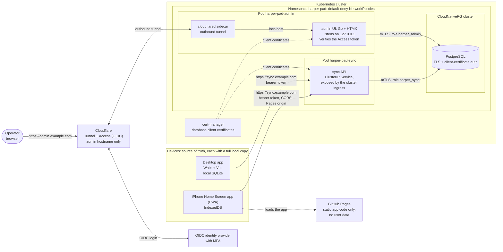
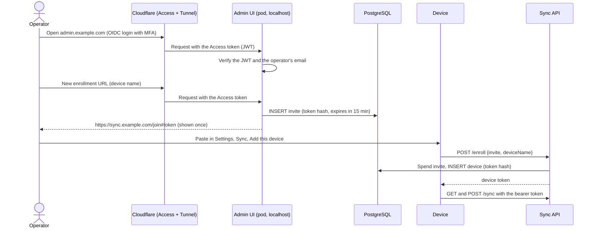

# Sync (design)

Status: **proposal, not built.** This page describes an optional sync service so **notes** (the scratch pad drafts)
follow the user between the desktop app and the iPhone Home Screen app. Nothing here is in the code yet. When it is
built, this page becomes the reference and [storage](storage.md), [security](security.md) and [architecture](architecture.md)
get the matching changes (see [Documentation changes](#documentation-changes)).

## Goals and non-goals

Goals:

- The same drafts on the desktop app and the web app (the iPhone Home Screen app is the web build).
- Works offline: editing never waits for the network, and changes made offline are sent when the app next syncs.
- **The device is the source of truth and the server is a supporting system.** If the whole backend is lost, syncing from a device
  rebuilds it ([The client is the source of truth](#the-client-is-the-source-of-truth)).
- Off by default. A user who never turns it on has no network use beyond today's update check, and the security page's
  "no server" statement stays true for them.
- Small to run: a Go sync service, a tiny Go + HTMX admin container and PostgreSQL, on the user's own domain.

Non-goals for v1:

- **Syncing settings.** The personal dictionary, the ignore list, text size and every other setting stay on the device. What
  syncs is notes. Settings can be added later ([Later](#later)).
- **End-to-end encryption.** In v1 the server can read drafts. The wire format keeps the draft as an opaque string, so v2
  ([v2: end-to-end encryption](#v2-end-to-end-encryption)) can add encryption without changing how docs are pushed and pulled.
- **More than one user.** One server holds one user's data. There are no accounts, only devices.
- **Real-time collaboration or merging text.** Conflicts keep both versions; they are not merged.
- **Syncing files.** A draft's link to a file on disk stays on the device.

## The client is the source of truth

The server is a relay and a replica: it is what lets a second device have the same notes. Each device holds a complete copy and is
authoritative for it. These rules apply to every part of the design below, and where something else in this page seems to
conflict with them, they win.

1. **Local first.** Every read and write uses the device's own store; sync runs behind it. The app behaves the same with sync off,
   the server down or the token revoked, and a failed sync never blocks or loses an edit.
2. **Absence is not deletion.** Only an explicit tombstone deletes a draft. A doc that is missing on the server (a new server, a
   restore from an older backup, a failed write) is something to **upload**, never something to remove locally.
3. **Sync never changes what the user is working on.** A pull never overwrites a draft that has unsent edits. In a conflict the
   local text keeps its id and the other version becomes a "conflicted copy" ([Conflicts](#conflicts)), so the open editor never
   changes under the user.
4. **The server cannot destroy local data.** Revoking a device, an expired or invalid token, a server reset and "Sign out" all
   leave the local drafts in place; sync just stops.
5. **Any device can rebuild the server.** See [Rebuilding a lost or restored server](#rebuilding-a-lost-or-restored-server).
6. **What only the server holds is disposable or re-creatable.** Devices and tokens (re-enroll), tombstones and the cursor
   are the only such things; in v2 the key bag is also kept on each device.

What losing the whole server costs:

| Lost | Effect |
|---|---|
| Drafts | Nothing: rebuilt from the devices |
| Devices and tokens | Every device shows "Sign in again". Create one enrollment URL per device in the admin UI; local data is untouched |
| Tombstones | A draft deleted on one device while another was offline can **reappear** when that other device re-uploads. Harmless and rare: delete it again |
| v2 key bag | Re-uploaded from a device's local copy ([v2](#v2-end-to-end-encryption)) |

## Decisions

| Decision | Choice | Why |
|---|---|---|
| Server | A new Go service, `harper-pad-sync`, as a Kubernetes Deployment behind a ClusterIP Service, exposed through the cluster's ingress | Small, one static binary; applies the same draft limits as the app, written separately (see Code layout) |
| Database | PostgreSQL run by the **CloudNativePG operator** in the same cluster, authenticated with **client certificates** (mTLS), no passwords | cert-manager issues and renews the certificates; the sync service and the admin UI each get their own certificate and a role, the admin one with least privilege |
| Admin | A separate tiny Go + HTMX container for enrollment URLs and device management, **reached only through a Cloudflare Tunnel behind Cloudflare Access with OIDC login** | No inbound port and no login code to write; keeps administration out of the public API. See [the admin UI](#the-admin-ui) for what this trusts |
| Hosting | Kubernetes. The sync API is exposed through the cluster's existing ingress on the user's own domain, with a Let's Encrypt certificate from cert-manager. Only the admin UI goes through a **Cloudflare Tunnel** (a `cloudflared` sidecar in its pod) | iOS trusts the certificate and sync traffic never passes through a third party; Cloudflare handles only the admin pages ([what this trusts](#what-this-trusts)) |
| Web build | Stays on GitHub Pages (`harper.portableinfo.cloud`) | Already deployed; sync is a different origin, so CORS and the CSP change |
| Code layout | `backend/` in this repository, as its **own Go module that shares no code with the app**; the sync client stays in the frontend | The overlap is about 30 lines of draft rules, and a shared module or a single module costs more than writing them twice. The end-to-end test runs the real client against the real server, which is what catches drift. The release workflow gains two artifacts, the sync and admin images |
| Users | One | No account table or sharing rules |
| Client | One JavaScript sync module used by both builds, on top of `backend.js` | The web build has no Go side; one implementation means one set of bugs |
| Auth | One opaque, long-lived bearer token per device, no refresh tokens | See [Authentication](#authentication) |
| Stolen-token hardening | v1: a device list with last-seen and a 30-day idle expiry, revoking in the admin UI. v1.1: a device-bound signing key | See [Limiting the damage of a stolen device](#limiting-the-damage-of-a-stolen-device) |
| Encryption of content | None in v1 (TLS only); end-to-end in v2 | Keeps the first version small; see [v2](#v2-end-to-end-encryption) |
| Conflicts | Server-assigned versions; the local text keeps its id and the other version becomes a "conflicted copy" draft | Never loses text, no merge logic, the open editor never changes under the user |
| Source of truth | The device. The server can be rebuilt from any device | A supporting system must not be able to lose or destroy notes; see [the principles](#the-client-is-the-source-of-truth) |

## Overview



| Component | Runs as | Reachable from | Does |
|---|---|---|---|
| `harper-pad-sync` | Deployment and ClusterIP Service | The cluster's ingress only (NetworkPolicy) | The API: enroll, sync, devices |
| `harper-pad-admin` | Deployment; the pod also runs a `cloudflared` sidecar | The admin hostname through Cloudflare, behind Access with OIDC login; listens on 127.0.0.1, so only the sidecar can connect | Creates enrollment URLs, lists, renames and revokes devices |
| PostgreSQL | CloudNativePG `Cluster` | Port 5432, only from the sync and admin pods (NetworkPolicy) | All server state; accepts only TLS connections with a valid client certificate |
| cert-manager | Cluster add-on | Nothing | Issues the database client certificates and the sync domain's TLS certificate |
| Cloudflare | External | The internet | Carries the admin tunnel and runs Access on the admin hostname. Not in the sync path |
| GitHub Pages | Static hosting | The internet | Serves the web app's code; holds no user data |

Each device keeps its own full copy (SQLite on desktop, IndexedDB in the browser) and works without the server. The sync module
pushes local changes and pulls remote ones. The server is the only place versions are assigned, so devices never compare clocks.

### Database access

No workload has a database password. PostgreSQL requires TLS and a client certificate for every connection, and the clients
verify the server certificate (`sslmode=verify-full`, with the cluster's server CA mounted in each pod).

- **Certificates:** cert-manager issues one `Certificate` per role (usage `client auth`, common name equal to the role name) from
  an issuer whose CA is given to the cluster as `spec.certificates.clientCASecret`. With a custom client CA the cluster no longer
  holds the signing key, so the `kubectl cnpg certificate` helper cannot be used and cert-manager is the issuer. Each pod mounts
  its certificate Secret as a volume (not a `subPath`, so renewals reach the pod), and the app re-reads the files for new
  connections, so renewal needs no restart.
- **Authentication rules:** `spec.postgresql.pg_hba` requires `cert` for these roles over `hostssl`, and the roles have no
  password. The exact entries, their order relative to CloudNativePG's own defaults, and whether the common name must equal the
  role (otherwise a `pg_ident` map) are to be confirmed against the operator version in use; they are not verified here.
- **Network:** a NetworkPolicy lets only the sync pods and the admin pods reach port 5432 (plus what the
  operator itself needs).

| Role | Used by | Allowed |
|---|---|---|
| `harper_sync` | `harper-pad-sync` | Owns the tables and runs the migrations at start (including the grants to `harper_admin`); reads and writes `docs`, `meta` (and the key bag in v2), `devices` and `invites` |
| `harper_admin` | `harper-pad-admin` | `invites`: insert, select, delete; `devices`: select, update (rename), delete (revoke); `audit`: insert, select. **No access to `docs`**, so a compromised admin UI cannot read notes. No DDL, and it cannot change the schema |

### The admin UI

A small Go server rendering HTML with HTMX, in its own pod so the public API carries no administration code. It listens on
127.0.0.1, has no Service reachable from outside, and nothing routes to it except its own sidecar. It is reached through a
**Cloudflare Tunnel**: a `cloudflared` sidecar in the same pod makes an outbound-only connection to Cloudflare and forwards to
`http://localhost:<port>`, and a **Cloudflare Access** application in front of the tunnel makes the operator sign in with an OIDC
identity provider before any request reaches the pod. The sync API is not behind Cloudflare; the cluster's ingress serves it.

What it does: **create an enrollment URL** (the one action that needs to be easy), list devices with name, last-seen and user
agent, rename, and revoke. It reads the sync service's public address from its configuration, which is how it builds enrollment
URLs, and keeps an audit log of who did what. It has no feature that reads or writes notes, which is why its database role has no access to them.

#### Login: Cloudflare Access with OIDC

- **Access application** for `admin.example.com`, with the OIDC identity provider added as its login method (MFA is enforced at the
  identity provider). The policy allows only the operator's identity (an email, or a group at the provider), and the session is
  short, for example a few hours.
- **The admin app does not trust that a request came through Access.** On every request it verifies the
  `Cf-Access-Jwt-Assertion` header: the RS256 signature against the team's signing keys (the JWKS at
  `https://<team>.cloudflareaccess.com/cdn-cgi/access/certs`, cached and refreshed when an unknown `kid` appears), `iss` equal to
  the team domain, `aud` equal to this application's AUD tag, `exp`, and the `email` claim in the configured allowlist. It ignores
  the plain `Cf-Access-Authenticated-User-Email` header, which anything that can reach the container could forge. A request
  without a valid token gets a 403, so a misrouted request or something else on the internal network cannot use the admin UI.
- **Still needed inside the app:** a CSRF token on every state-changing request and an `Origin` check against the admin host
  (the session is a cookie), and the same strict Content-Security-Policy as the app (no inline scripts).
- **Alternative:** skip Access and make the admin app an OIDC client itself (authorization code flow with PKCE and its own session
  cookie) behind the tunnel. That removes the dependency on Cloudflare for authentication, at the cost of login code in the app.
  The design uses Access plus token verification because it has no login code to write or get wrong.

#### What this trusts

- **Cloudflare terminates TLS for the admin hostname,** so it can see the admin pages, including the enrollment URL shown on
  the page. It is **not** in the sync path: note text and sync tokens go from the device to the cluster's ingress, never through Cloudflare. The
  enrollment invite is single use and expires in 15 minutes, and the device it enrolls appears in the device list, so a stolen
  invite is noticed, but not prevented. If the domain's DNS is on Cloudflare, set the sync hostname to **DNS only** (not proxied),
  or its traffic would pass through Cloudflare after all.
- **Admin access is the ability to enroll a device, and in v1 a device can read every note.** That the admin's database role cannot
  read notes does not make a compromised admin UI harmless. Whoever controls the operator's identity provider account, the
  Cloudflare account or the Access policy can create an invite and enroll their own device. So MFA at the identity provider and on
  the Cloudflare account are part of the security of the notes. Mitigations in this design: the "new device enrolled" notice on
  every device ([hardening](#limiting-the-damage-of-a-stolen-device)), the audit log, and in v2 a new device also needs the
  passphrase or recovery key. A further option is to require approval of a new device on an already-enrolled one (open question).

### Enrolling a device



## Enrollment

Every device, including the first, enrolls the same way.

1. In the admin UI the operator picks **New enrollment URL**. It shows `https://sync.example.com/join#<token>` once. The token is 256
   random bits, valid for about 15 minutes and for one use, and is stored only as a hash. It is in the URL **fragment** so it is not
   sent in the request line and not written to access logs.
2. On the device: Settings, Sync, **Add this device**, then paste the URL. The URL carries the server address and the token, so
   there is no separate server field.
3. The app generates nothing secret itself. It calls `POST /enroll` with the invite token and a device name and gets back a device
   token. The invite is now spent.
4. The app stores the device token and runs the first sync ([First sync](#first-sync)).

Why paste instead of opening the link: on iPhone, a tapped link opens Safari, which has separate storage from the installed Home
Screen app, so the enrollment would land in the wrong place. Pasting inside the installed app avoids it. The URL is only a
convenient way to carry the address and token in one string; opening it in a browser shows a short "copy this into Harper Pad" page.

States to design: sync off, paste the URL, error (invite expired or used, server unreachable, not HTTPS), first-sync
progress (merge only), and the device list with rename and revoke. Follow the [design cheat sheet](design-cheatsheet.html), keep transitions
short, and honour reduced motion.

## Authentication

After enrollment every request carries `Authorization: Bearer <device token>`.

- The token is 256 bits from a cryptographic random source. The server stores only its SHA-256 (a fast hash is enough for a
  high-entropy secret) and looks it up in constant time.
- It is **per device** and revocable: the server keeps the name, creation time and last-seen time, and deleting the row makes the next
  request a 401.
- There is no refresh token. The server is the only verifier, so it can check every token and revoke immediately; short-lived
  tokens would add rotation, reuse detection and cross-tab races without improving anything, because the web build stores both
  tokens in the same place (IndexedDB).
- A token unused for 30 days is treated as expired, so forgotten devices clean themselves up.
- On a 401 the client stops syncing and shows "Sign in again", which goes back to **Add this device** with a new invite. This also
  covers iOS clearing a Home Screen app's storage.
- A bearer header, not a cookie, so a page on another site cannot make the browser attach credentials (no CSRF).
- Bad tokens and bad invites get the same generic 401 and are rate limited.

Revisit refresh tokens if the design gains multiple users, sharing, a third-party client, a native iOS app that can use the
Keychain, or an identity provider. The wire format (`Bearer`) is the same, so the change would be on the server.

### Limiting the damage of a stolen device

Two different attackers need different answers, and the design treats them separately.

| Attacker | What they have | What helps |
|---|---|---|
| **Copies the token** (a backup, a disk image, a dump of IndexedDB) but does not keep the device | The bearer token | A device-bound key (v1.1); revocation; idle expiry |
| **Uses the unlocked device** (or script running in the page) | The token, the key, and the drafts themselves | Revocation and the strict CSP. Nothing else can stop a legitimate client being used, and its edits and deletions sync to the other devices; there is no server-side undo in v1 (see [Later](#later)) |

**v1 (cheap, covers both):**

- **A device list** with name, created, last-seen, and the user agent, in the admin UI, where a device is also revoked.
- **A notice** (a banner on the next open of each device) when a device enrolls or is revoked.
- **30-day idle expiry**, above.

**v1.1: a device-bound signing key (proof of possession, in the style of DPoP, RFC 9449).**

At enrollment the device generates an ECDSA P-256 key pair and sends the public key (JWK) with `POST /enroll`; the server stores it
on the device row. After that, every request carries the bearer token **and** a proof header:

```
Harper-Proof: <timestamp>.<nonce>.<signature>
```

The signature is over `method`, the request path, `timestamp`, `nonce` and the SHA-256 of the bearer token, made with the device's
private key. The server checks that the signature verifies against the stored public key, that `timestamp` is within about 60
seconds of its clock, and that the `nonce` has not been seen in that window (a small in-memory cache is enough for one user). A
copied token without the key is then useless.

Where the private key lives:

| Build | Key storage |
|---|---|
| Web (iPhone Home Screen app, browsers) | `crypto.subtle.generateKey` with `extractable: false`; **only the private `CryptoKey`** is stored in IndexedDB (a `CryptoKeyPair` cannot be stored); the public key is exported as a JWK and sent to the server |
| Desktop | The OS keyring where there is one; otherwise a file readable only by the user |

Details that are easy to get wrong:

- **WebCrypto's ECDSA signature is raw `r‖s` (64 bytes for P-256), not DER.** Go's `ecdsa.VerifyASN1` will reject it; the server must
  split it into two 32-byte integers and call `ecdsa.Verify`.
- **Losing the key means re-enrolling.** If the browser or iOS clears storage, the proof fails and the client shows "Sign in
  again", the same recovery as an expired token. Call `navigator.storage.persist()` (`keepData()`) as the app already does.
- **Fallback during rollout:** a device enrolled without a key (v1) keeps working with the bearer token alone until the operator
  turns on `--require-proof`. The client re-enrolls to get a key.
- **Limits:** it does not stop script running in the page, or someone using the unlocked device, because both can ask the key to
  sign. The RFC says the same of DPoP. Only preventing XSS (the strict CSP in [security](security.md)) addresses the first, and
  revocation the second.
- **Not verified on iOS yet.** Storing and using a non-extractable key worked in a Chromium test, but it has not been run on
  WebKit or in an installed iPhone app. The iPhone check in `TODO.md` decides whether this step goes ahead as written.

**Not planned:** rotating the token on a schedule with reuse detection, and a separate refresh token. A device-bound key covers the
copied-token case better and has no refresh race (two tabs, the service worker, a response lost when iOS suspends the app). If the
key turns out not to work on iOS, rotation with reuse detection is the fallback: issue a new token in a response once the old
one is a day old, keep the previous one valid for about 10 minutes, and revoke the device if the previous one is presented after that.

## Data model

### What syncs

| Item | Synced fields | Not synced |
|---|---|---|
| Draft | `id`, `created_at`, `updated_at`, `format`, `content` | `title`, `excerpt`, `tasks*` (derived, recomputed on save), `file_path`, `file_mtime` (belong to one device's disk) |

Everything else stays on the device: the personal dictionary, the ignore list, text size and the other settings. Only drafts sync.

Draft ids are already 16 bytes (6 of time, 10 random) as 32 hex characters (`internal/store/drafts.go`, `newID`), so devices
can create drafts offline without colliding.

### Server schema (PostgreSQL)

```sql
CREATE SEQUENCE change_seq;                       -- the one change counter for the whole server

CREATE TABLE meta (
  key   TEXT PRIMARY KEY,
  value TEXT NOT NULL                             -- 'schema_version', 'server_id', (v2) 'encrypted'
);

CREATE TABLE docs (
  id         TEXT    PRIMARY KEY CHECK (id ~ '^[0-9a-f]{32}$'),
  version    BIGINT  NOT NULL,                    -- change_seq value at the last accepted change
  created_at BIGINT  NOT NULL,                    -- the device's timestamps, Unix ms, as in the app
  updated_at BIGINT  NOT NULL,
  deleted    BOOLEAN NOT NULL DEFAULT FALSE,      -- a tombstone; data is cleared when this is set
  data       TEXT    NOT NULL DEFAULT '' CHECK (octet_length(data) <= 8388608)
);
CREATE UNIQUE INDEX docs_version_idx ON docs (version);

CREATE TABLE devices (
  id         TEXT   PRIMARY KEY,
  name       TEXT   NOT NULL,
  user_agent TEXT   NOT NULL DEFAULT '',
  token_hash BYTEA  NOT NULL UNIQUE,              -- SHA-256 of the bearer token
  public_key TEXT   NOT NULL DEFAULT '',          -- v1.1: the device's signing key (JWK)
  created_at BIGINT NOT NULL,
  last_seen  BIGINT NOT NULL
);

CREATE TABLE invites (
  token_hash  BYTEA  PRIMARY KEY,
  device_name TEXT   NOT NULL DEFAULT '',         -- entered in the admin UI, copied to the device on enrollment
  created_by  TEXT   NOT NULL,                    -- operator email from the Access token
  created_at  BIGINT NOT NULL,
  expires_at  BIGINT NOT NULL,
  used_at     BIGINT                              -- NULL until spent
);

CREATE TABLE audit (
  id     BIGSERIAL PRIMARY KEY,
  at     BIGINT NOT NULL,
  actor  TEXT   NOT NULL,
  action TEXT   NOT NULL,                         -- 'invite.create', 'device.rename', 'device.revoke'
  detail TEXT   NOT NULL DEFAULT ''
);

-- v2 only, in a later migration
CREATE TABLE keybag (
  id      SMALLINT PRIMARY KEY CHECK (id = 1),    -- one user, one key bag
  version BIGINT   NOT NULL,                      -- compare-and-set
  data    TEXT     NOT NULL                       -- opaque JSON: wrapped data key, KDF parameters, check value
);
```

The sync role owns the tables and sets the admin role's grants in the migration:

```sql
GRANT SELECT, INSERT, DELETE ON invites TO harper_admin;
GRANT SELECT, DELETE ON devices TO harper_admin;
GRANT UPDATE (name) ON devices TO harper_admin;       -- rename only
GRANT SELECT, INSERT ON audit TO harper_admin;
GRANT USAGE ON SEQUENCE audit_id_seq TO harper_admin;
-- nothing on docs, meta or keybag
```

How it is used:

- **The cursor.** `version` comes from `change_seq`, which increases on every accepted change anywhere. A client's cursor is the
  highest version it has seen, so a pull is one indexed query: `WHERE version > $1 ORDER BY version LIMIT $2`, which includes
  deletions (`deleted = TRUE`).
- **Writes are serialized.** A sequence hands out numbers before commit, so two concurrent pushes could commit out of order, and a
  client that had already read the higher number would never see the lower one. Every push transaction therefore starts with
  `pg_advisory_xact_lock(<constant>)`, so the next number is allocated only after the previous push has committed. For one user this
  costs nothing.
- **A push is one transaction:** take the lock, lock the doc's row, compare `base_version`, take `nextval('change_seq')`, then
  upsert.
- **Tombstones clear the text,** so a deleted note's content is not kept on the server. They are kept forever.
- **Spending an invite is one statement,** so two devices cannot use it at once:
  `UPDATE invites SET used_at = $now WHERE token_hash = $1 AND used_at IS NULL AND expires_at > $now RETURNING device_name`. A
  periodic delete removes expired invites.
- **Revoking a device deletes its row.** The "new device added" banner comes from `created_at`.
- **Times are `BIGINT` Unix milliseconds,** matching the app and the device-supplied times that survive a rebuild.
- **The 8 MiB check** is a backstop. The app enforces the 5 MB draft limit, and v2's base64 envelope is larger than the plaintext.

The server validates what the app validates: drafts at most 5 MB of valid UTF-8, a known format, a strict id. All SQL uses `$1`-style parameters.

## Protocol

JSON over HTTPS. Every route except `/enroll` needs the bearer token.

| Route | Purpose |
|---|---|
| `POST /enroll` | `{invite, deviceName}` returns `{deviceToken}`. Spends the invite. |
| `GET /sync?since=<cursor>&limit=<n>` | `{changes: [...], cursor, more}`: docs changed after the cursor, deletions included. |
| `POST /sync` | `{changes: [{id, baseVersion, deleted, data, ...}]}` returns, per change, `ok` with the new version, or `conflict` with the server's current copy. |
| `GET /devices`, `PATCH /devices/<id>`, `DELETE /devices/<id>` | List, rename, revoke. |

A change is accepted only if `baseVersion` equals the server's current version for that id (0 for a new one). Otherwise the server
answers `conflict` and includes its copy. A deletion is a change with `deleted: true`.

**Rebuilding.** Two rules let a device re-upload everything to an empty or older server without conflicts:

- Every response carries the server's `serverId`, a random id made when its database is created. The client stores it with its
  cursor ([Rebuilding a lost or restored server](#rebuilding-a-lost-or-restored-server)).
- A push with `baseVersion` 0 for an id the server already has is accepted when the data is **identical** (the answer is `ok`
  with the current version) or when the pushed `updatedAt` is **newer** than the server's (the server's old state is replaced). Otherwise it is a `conflict`. A normal new draft never hits this, because ids are unique.

### Conflicts

A conflict is settled **on the device**, by comparing, and only when it is not clearly just an update. For each draft the device
compares three things: its own text now, the text as it was at the last sync (`synced_hash`, below), and the server's current
version.

| This device | The server | What happens |
|---|---|---|
| Unchanged since the last sync | A newer version | **Plain update:** apply it. No copy. |
| Changed | Unchanged since the last sync | **Plain update:** push it. No copy. |
| Changed | Changed, with the same text and format | Adopt the server's version number. No copy. |
| Changed | Changed, with different text | **Conflict:** make a copy (below). |
| Changed | Deleted | The edit survives and the draft is restored, as "undo delete" does today. No copy. |
| Unchanged | Deleted | Apply the deletion. |

"Changed" means the text's hash differs from `synced_hash`, not that the draft was touched, so typing something and then undoing it
is unchanged, and a newer remote version applies as a plain update.

**The copy is created locally.** The server's different version is saved on this device as a **new draft** whose first line is
prefixed with "Conflicted copy" and the time. The device's own text keeps its id, because it is what the user may have open and be
typing in ([the principles](#the-client-is-the-source-of-truth), rule 3). The device then pushes its own text on top of the server's
version. The copy is an ordinary draft: it syncs like any other, so other devices receive the text under the original id and the copy
as a new draft. Nothing is lost, and the user decides which to keep and deletes the other.

A pull never overwrites a draft that has unsent edits: that draft is pushed first and goes through the table above if the server
disagrees. The server never makes copies and never merges text.

### First sync

When a device enrolls it **merges**: it uploads its local drafts as new docs and pulls the remote ones. Merge cannot overwrite
anything, because ids are unique, and there is no "replace local with the server's" choice, because the server must not be able to
discard what a device holds ([the principles](#the-client-is-the-source-of-truth), rule 4). A user who wants a clean device deletes
the drafts on it first, which is an ordinary delete.

### Rebuilding a lost or restored server

The server can lose state in two ways: it is **replaced by an empty one**, or **restored from an older backup**. The client
notices either and re-uploads what the server lacks.

- **Detecting it.** The client stores the `serverId` it last saw and its cursor. A different `serverId` (a new database), or a
  cursor higher than the server's change counter (an older backup), means the server's state no longer matches. A token the new
  server does not know is a 401, so devices first show "Sign in again" and re-enroll with a fresh invite; the first sync after
  that takes the same path.
- **Resetting the sync state.** The client keeps all drafts, clears every `synced_hash` (so every draft counts as changed) and sets `server_version` to 0, sets the
  cursor to 0, drops pending tombstones (a delete that the lost server never saw is moot), and stores the new `serverId`. Then
  it runs a normal sync: the push uploads everything, in resumable chunks, keeping each draft's own `created_at` and `updated_at`.
- **Several devices.** The first device to sync repopulates the server. Each later device pushes the same ids with `baseVersion` 0;
  the push rules in [Protocol](#protocol) make identical content a no-op, so they converge without conflicted copies. Devices
  that diverged (an edit made while the server was gone) produce one conflicted copy, as usual. In v2 the data is encrypted with
  fresh nonces, so the server cannot compare content: it answers `conflict`, and the client decrypts the server's copy, finds it
  equal to its own, and adopts the version without making a conflicted copy.
- **What the operator does.** Start the new server and database, create an enrollment URL in the admin UI for each device, and paste it on that device. Nothing else.
- **Cost.** The whole data set is uploaded once. With the 5 MB per-draft limit and a personal collection this is small, but it is
  chunked and resumable, so a phone that is suspended partway carries on later.

### When it runs

On start, when the page becomes visible or the window regains focus, about 2 seconds after a save (debounced), and on a timer while
the app is open. iOS has no background sync, so a change made offline waits for the next time the app opens. A sync never blocks
typing; the status bar shows only "Synced", "Syncing", "Offline" or "Sign in again".

## Changes to local storage

The groundwork, and the riskiest part, because it touches both storage engines. It changes nothing for a user who leaves sync off.

- **Tombstones.** `DeleteDraft` is a hard delete today (`DELETE FROM drafts`), so a deletion cannot be sent. Keep a small record of
  deleted ids that are pending upload, and remove it once the server has acknowledged it.
- **Per-draft sync state:** `server_version` (the version last seen) and `synced_hash` (a hash of the text and format at the last
  sync). A draft is dirty when its current hash differs from `synced_hash`. Both are local columns; neither is sent.
- **A way to apply remote changes without rewriting them.** `Store.Save` always sets `updated_at` to now and recomputes the
  summary, which is right for typing but wrong for applying a pulled draft, whose timestamps must be kept and which must not be
  marked dirty; it sets `synced_hash` to the applied text. Add a separate store method for it, with the same validation.
- **Migrations.** SQLite `PRAGMA user_version` 2 to 3, and `DB_VERSION` for IndexedDB, both upgrading an old database in place
  and refusing a newer one as they do now. Update the shared fixtures so the Go and the frontend tests keep checking the same
  cases.
- **Rebuild support.** The device also stores the `serverId` it last saw, and a "reset sync state" operation that sets every draft
  changed (empty `synced_hash`) with `server_version` 0, clears pending tombstones and zeroes the cursor
  ([Rebuilding](#rebuilding-a-lost-or-restored-server)). Pulling must skip any draft with `dirty` set.
- **Device-local sync settings** (server URL, device token, cursor, `serverId`, device name) are kept apart from the app's own settings and are
  never uploaded. On desktop that is a separate table or key set; in the browser a separate IndexedDB key.
- New host calls go through `backend.js` with both implementations, as [pages](pages.md) requires. New Go service methods mean
  running `make bindings`.

## Security

This is a bearer-token model with transport security and no content encryption.

| Concern | Handling |
|---|---|
| Transport | HTTPS only, on a Let's Encrypt certificate (cert-manager) for the sync domain, terminated at the cluster's ingress, with HTTP redirected and HSTS set. The client refuses an `http:` server. |
| Who can read the data | The server and its operator; content is not encrypted until v2. Cloudflare is not in the sync path and sees only the admin UI. Protect the cluster with encrypted volumes and tight access to the namespace, protect backups like the live data, and keep request bodies out of logs (the ingress access logs must not include bodies). The settings screen says this plainly. |
| Stolen device token | Revoke that device from another device or the admin UI; 30-day idle expiry; from v1.1 a device-bound key makes a copied token useless. The token grants only this one user's data. See [Limiting the damage of a stolen device](#limiting-the-damage-of-a-stolen-device). |
| Invite theft | One use, 15 minutes, hashed at rest, in the URL fragment. |
| Database access | TLS and client certificates only, no passwords; certificates issued and renewed by cert-manager; PostgreSQL reachable only from the sync and admin pods by NetworkPolicy; separate roles for sync and admin, the admin one with least privilege ([Database access](#database-access)). |
| Cluster | Default-deny NetworkPolicies; the sync pods reachable only from the ingress controller; the admin pod has no Service and listens on loopback; hardened pods, no Kubernetes API token, images pinned by digest. |
| Admin UI | No Service and no listener outside its pod; reached only through a Cloudflare Tunnel sidecar behind Cloudflare Access with OIDC login and MFA at the identity provider; the app verifies the Access token on every request; CSRF tokens, same-origin checks, strict CSP, an audit log. Its database role cannot read notes, **but admin access can enroll a device, and a device reads the notes** (v1), so the identity provider and Cloudflare accounts are part of the trust chain. See [the admin UI](#the-admin-ui). |
| Guessing | 256-bit tokens; rate limits and generic 401s on `/enroll` and on bad tokens. |
| Cross-origin use | CORS allows exactly the Pages origin and the desktop app's webview origin, not `*`, and only the headers and methods the API uses. Bearer headers, not cookies. |
| Abuse and size | Request and field limits as in the app, a per-server quota, and a limit on changes per request. |
| Content-Security-Policy | `connect-src` is `'self'` today. Add the sync origin only when sync is configured (a build-time setting for the web build; the desktop page is embedded, so it needs the origin in its policy too), and change nothing else. See [security](security.md). |
| Token at rest on the client | On the web it is in IndexedDB, readable by any script on the origin, which the strict CSP (no inline scripts, no `eval`) is there to prevent. On desktop it is in the local database, outside the app's other settings, and never uploaded. Neither is encrypted; there is no OS keyring in the web build. |
| Draft text from the server | Treated as untrusted data like any pasted text: never run, never put in the page as HTML, validated before it is stored. |

Not defended: a compromised device (it has the data, and can edit or delete notes with no server-side undo), a compromised server (it has the data in v1; in v2 it has only ciphertext,
see [v2](#v2-end-to-end-encryption)), and traffic analysis (the server sees sizes and times).

## Deploying the server

Everything runs in one Kubernetes namespace, `harper-pad`, described by manifests that live in the cluster's own
GitOps repository, not in this one (this section is their specification):

- **PostgreSQL:** a CloudNativePG `Cluster` with one instance to start (one user, and devices can rebuild the server, so high
  availability is not needed), the client CA and `pg_hba` settings above, and the certificates from cert-manager. CloudNativePG's
  scheduled backups to object storage are **recommended but not required for the notes' safety**, because every device holds a
  full copy and can rebuild the server; a backup preserves what devices do not have: tombstones and the device list. Restoring an
  older backup is handled by the client ([Rebuilding](#rebuilding-a-lost-or-restored-server)).
- **Migrations:** the sync service applies them itself at start, under its own role, taking a PostgreSQL advisory lock so that
  only one pod migrates if there is ever more than one replica. It refuses to start if the database has a newer schema than it
  knows. The admin service starts only against a schema it recognises, and does not migrate.
- **`harper-pad-sync`:** a Deployment (one replica to start) and a ClusterIP Service, with a single container. The ingress (Traefik)
  routes the sync domain to the Service (an `IngressRoute`, or a standard Ingress), with the TLS certificate from a cert-manager
  `Certificate` (Let's Encrypt) and these middlewares: redirect HTTP to HTTPS, HSTS and standard security headers, a rate limit
  per client IP, and a request body cap slightly above the largest allowed request. CORS stays in the app, with its explicit
  allowlist. The app takes the client IP from `X-Forwarded-For` only because the NetworkPolicy lets nothing but the ingress controller connect to
  it. The in-memory rate limiter and, from v1.1, the proof nonce cache are per pod, so move them to PostgreSQL before running
  more than one replica.
- **`harper-pad-admin`:** a Deployment (one replica) with **no Service**. The pod has the app container, listening on
  127.0.0.1, and a `cloudflared` sidecar (a native sidecar container where the cluster supports them, so the tunnel is up before
  the app and outlives it). The tunnel token is a Kubernetes Secret passed as `TUNNEL_TOKEN`; the tunnel is remotely managed and
  maps the admin hostname to `http://localhost:<port>` in Cloudflare. Cloudflare's own Kubernetes guide runs `cloudflared` as a
  separate Deployment pointing at Services; the sidecar is chosen so the admin app can listen on loopback only, which means no
  other pod can reach it. The cost is that the two scale and restart together.
- **NetworkPolicies:** default deny for ingress and egress in the namespace, then allow:
  - DNS, and the sync and admin pods to PostgreSQL on 5432;
  - ingress to the sync pods from the ingress controller's pods only, and none to the admin pod;
  - the admin pod out to Cloudflare for the tunnel (the ports Cloudflare documents) and to the Access team domain on 443 for the
    signing keys;
  - nothing else out of the sync pods.

  The cluster's network plugin has to enforce NetworkPolicy.
- **Pod hardening:** non-root, read-only root filesystem, all capabilities dropped, the runtime-default seccomp profile, no
  Kubernetes API token (`automountServiceAccountToken: false`, because neither app talks to the Kubernetes API), resource limits, and
  images pinned by digest.
- **Configuration:** `PUBLIC_URL` must be `https:` or the service refuses to start. The ingress terminates TLS, so the app sees plain
  HTTP and takes the scheme from this setting, not from a forwarded header. The admin pod also gets the Access team domain, the
  application's AUD tag and the operator email allowlist.
- **Health:** a liveness endpoint, and a readiness endpoint that checks the database connection.

Commands: `harper-pad-sync serve` and `harper-pad-admin serve`. Enrollment, devices and revoking are in the admin UI, not
on the command line.

## End-to-end test

A small test that runs the real pieces together, because only that proves the JavaScript sync client, CORS, the CSP, IndexedDB, TLS
and the server work as one. It is a Playwright script driving a real Chromium against a compose stack.

- **The stack:** a compose file with three services, built or pulled and started together:
  - **PostgreSQL**;
  - **`harper-pad-sync`**, built from its real Containerfile (`backend/Containerfile.sync`, with `Containerfile.admin` beside
    it), so the image, the listen address and the configuration guards are tested too;
  - **Caddy**, which provides HTTPS the way the cluster's ingress does in production.

  The compose file avoids features only Docker has, so `podman compose` and `docker compose` both run it; the `make` target uses
  whichever is installed.
- **HTTPS with Caddy:** Caddy serves two sites with its internal CA (`tls internal`) on a high port, so a rootless runtime can bind it:
  `https://app.localhost:8443`, a static file server for the web build, and `https://sync.localhost:8443`, a reverse proxy to
  `harper-pad-sync`. Because the page and the API are on different https origins, as in production, CORS, the CSP `connect-src`
  and the client's "https only" rule are all exercised. `PUBLIC_URL` is `https://sync.localhost:8443`, so the service's guard stays
  strict and there is no development exception. Playwright runs with `ignoreHTTPSErrors`, so the browser does not need Caddy's root
  certificate. (Chromium resolves `*.localhost` to loopback by itself; confirm this, and that Caddy issues for these names, when
  the stack is built.)
- **The devices:** the web build, built for the root path and mounted into Caddy, and two Chromium contexts, each with its own
  IndexedDB, acting as device A and device B. There is no frontend container and no `vite preview`.
- **Invites:** the test inserts an invite row into PostgreSQL itself, with the same SHA-256 token hash the service uses. It does not
  go through the admin UI, which sits behind a Cloudflare Access login, and the admin app gets no "skip authentication" switch for
  tests. The admin UI gets its own small test later, with a locally signed Access token and a fake key set.
- **Checks, in this order:**
  1. **Enrollment:** device A pastes an invite URL and gets a token; using the same invite again fails.
  2. **Create and sync:** a draft made on A is in PostgreSQL, and device B, enrolled with its own invite, pulls it.
  3. **Update:** an edit on A reaches B as a plain update, with no "Conflicted copy" draft.
  4. **Lose the server:** wipe the database, restart the sync service, re-enroll, and check the drafts are rebuilt with no conflicted
     copies ([Rebuilding](#rebuilding-a-lost-or-restored-server)).
  5. **Later:** an offline edit on both devices makes a local conflicted copy, and a revoked token shows "Sign in again" while the local
     drafts stay.
- **Settings it needs:** the page origin in the CORS allowlist and the sync origin in the web build's CSP `connect-src`, so this
  test is where the build-time setting for the sync origin is first exercised.
- **Where it runs:** CI follows the pattern of `scripts/screenshots.sh` and its workflow (a pinned `playwright-core` driving
  the runner's Chrome); locally it is a `make` target.
- **What it does not prove:** mTLS to PostgreSQL (the compose database uses password or trust authentication; the production
  certificate setup is checked on a real cluster, see the open questions), the real ingress and its certificate, cert-manager,
  Cloudflare and Access, and Safari or WebKit behaviour.

## Build order

Each step is its own pull request, from a branch off `origin/main`, and each leaves the app working with sync off.

1. **Local groundwork.** Tombstones, dirty tracking, the apply-remote store method, both migrations, with tests for the Go store and
   the web store.
2. **The server.** Enrollment, sync, devices, the admin container, the database roles and certificate setup, tests (including conflicts, deletes and the limits).
3. **The sync module** (`lib/sync.js`), with the pure logic (what to push, how to apply, how to resolve a conflict) unit-tested
   with Node's runner against fixtures, and the [end-to-end test](#end-to-end-test) against the real server.
4. **UI:** the enrollment and status screens, the device list and the status bar state.
5. **Docs and policy:** the changes below, and the CSP change.
6. **Hardening (v1.1):** the device-bound signing key, after the iPhone check in `TODO.md` passes. The device
   list and idle expiry are in steps 2 and 4, not here.
7. **v2:** end-to-end encryption ([v2](#v2-end-to-end-encryption)), after v1 is in use. It is independent of step 6.

## Documentation changes

- [security](security.md): replace "no accounts, no server and no network use beyond the update check" with the opt-in
  description, add this page's threat table, and the `connect-src` change.
- [storage](storage.md): schema version 3, the new columns and the tombstone record.
- [architecture](architecture.md) and `AGENTS.md`: the sync module, the new binary and its layout.
- [pages](pages.md): the web build's sync origin setting and CORS.
- A server operations page (run, proxy, back up, rotate, revoke).

## Open questions

- **The desktop webview origin** for the CORS allowlist, and whether the embedded page's CSP can name the sync origin at build
  time or needs a setting at run time.
- **Which OIDC provider** signs the operator in, and whether to also allow only specific devices or networks in the Access policy.
- **Approval of new devices:** whether enrollment should additionally need a confirmation on an already-enrolled device, so that
  admin access alone cannot add a device that reads the notes.
- **The exact CloudNativePG settings** for certificate authentication of application roles: the `pg_hba` entries and their order, and
  whether the certificate's common name must equal the role name (otherwise a `pg_ident` map). Check against the operator version
  in use and test before relying on it.
- **Retention of tombstones on the server:** forever (simple) or pruned after every enrolled device has passed them (smaller). Start
  with forever; one user does not delete enough to matter.
- **Whether a non-extractable key works in the installed iPhone app,** and how often iOS clears it. Test plan in `TODO.md`.
- **How large the first upload can be** before it needs chunking, given the 5 MB per draft limit.

## v2: end-to-end encryption

Status: proposal, after v1 and the v1.1 device key. Goal: **the server stores only ciphertext**, so a compromised server, a stolen
backup of its database or a copied device token reveals no draft text. This does not need a new kind of server: it still stores
and returns opaque `data` strings by id and version.

### What the server sees afterwards

| Visible to the server | Not visible |
|---|---|
| Doc ids, versions, created and updated times, the deleted flag, the size of each blob, request times and the client's IP | Draft text and format |

The ids and times stay in the clear because the cursor and conflict handling need them. Sizes leak roughly how long a draft
is. There is **no feature loss from hiding the text**: search already runs on each device's local copy, never on the server.

### Keys

- **Data key (DK):** 256 random bits made once, on the first device that turns encryption on. It is never sent to the server in the
  clear.
- **Per-doc key:** `HKDF-SHA-256(DK, info = "harper-pad doc " + id)`. This keeps the number of encryptions under any one AES key
  small, so a random 96-bit nonce is safe, and a blob cannot be moved to another id and still decrypt.
- **Cipher:** AES-256-GCM through WebCrypto, native in every browser including iOS Safari and in the desktop webview, so the sync
  module needs no crypto library for the data itself. (XChaCha20-Poly1305 is not in WebCrypto.)
- **Key bag on the server:** the DK **wrapped** (AES-GCM) by a key-encryption key, plus the KDF parameters, so devices can fetch it.
  It holds one wrapping per unlock method, and the first version has two:
  1. **Passphrase.** The key-encryption key is `Argon2id(passphrase, salt)` with parameters stored in the key bag (a starting point:
     64 MiB, 3 passes, 1 lane), so they can be raised later. Argon2id is not in WebCrypto; use a pinned, audited WebAssembly
     implementation (the CSP already allows `'wasm-unsafe-eval'`) run in a worker, **for both builds** so the derivation is
     identical everywhere.
  2. **Recovery key.** A generated 160-bit secret shown once as groups of Base32 characters, to be saved in a password manager or
     printed. It wraps the same DK, so a forgotten passphrase is recoverable, and because it is high entropy it cannot be guessed
     offline.
- **A local copy of the key bag** on every device that has unlocked it. It is only ciphertext (the data key wrapped by the
  passphrase and recovery key), so keeping it is safe. It is what lets a device restore the server's key bag after a loss without
  ever exposing the data key, which the web build holds as a non-extractable handle and cannot re-wrap. A device re-uploads it
  before any doc ([principles](#the-client-is-the-source-of-truth), rule 6).
- **Check value:** the key bag also holds a small known string encrypted under the DK, so a wrong passphrase is rejected on the
  device, before anything is decrypted.
- **Passphrase change:** unwrap the DK, wrap it again under the new key-encryption key, and upload the key bag with a
  compare-and-set on its version. No document is re-encrypted.

The server can serve the key bag to any device that holds a valid token, so a thief with a copied token can try passphrases
**offline** against it. That is why the recovery key exists, why the parameters are strong, and why the setup screen enforces a long
passphrase (a strength meter, and a length floor of about 12 characters, or four or more random words) or offers to generate one.

### Envelope

Each doc's `data` becomes this JSON string; the server checks only that it has this shape and is within the size limit:

```json
{"v": 2, "kid": "k1", "n": "<base64 12-byte nonce>", "c": "<base64 ciphertext + 16-byte tag>"}
```

The plaintext is the v1 blob plus a revision counter: `{"v":1,"format":"markdown","content":"...","rev":12}`. The additional
authenticated data is `id || "|" || v || "|" || kid`, so a blob cannot be swapped between docs or relabelled. `kid` names the data
key, which lets a later rotation tell old blobs from new ones.

### What this does and does not stop

- **A server cannot alter a blob** without the device noticing (GCM fails). It **can** refuse to return one, hide a delete, or
  **serve an old valid version** of a doc (a rollback). Each device remembers the highest `rev` it has seen for each doc and rejects a
  lower one. A device that has never seen the doc cannot detect a rollback; say so in the docs.
- **A thief with a copied token** gets ciphertext only, and can offline-guess the passphrase (above).
- **A thief with the unlocked device** has the DK in use there. After revoking the device, run **Rotate key** (below), or the thief
  can still decrypt anything they already downloaded and anything uploaded under the old key.
- **Losing both the passphrase and the recovery key loses the data.** The server cannot help, and the setup screen says so before
  it finishes.

### Where the data key lives on a device

| Build | Storage |
|---|---|
| Web (iPhone Home Screen app, browsers) | After unlocking, the DK is imported as a **non-extractable** WebCrypto key (HKDF material) and only that handle is stored in IndexedDB, so the passphrase is entered once per device. Same assumption as the v1.1 device key, and the same iPhone check in `TODO.md` covers it. |
| Desktop | The OS keyring where there is one; otherwise a file readable only by the user, or ask for the passphrase at each start (a setting). |

### Turning it on (migration from v1)

1. The user picks **Turn on encryption** on a device (this is the one place that needs a device already enrolled and synced).
2. The app makes the DK, shows the recovery key, asks for a passphrase and uploads the key bag. From now on the server **rejects any
   `data` that is not an envelope** (`encrypted` flag on the server, set by the first key bag), and any request from a client that
   does not send `Harper-Protocol: 2` gets an error telling it to update. Without this, an old client would quietly keep
   uploading plaintext.
3. The device re-encrypts and pushes every local doc as a new version. Other devices see the key bag, prompt for the
   passphrase, unlock and carry on.
4. **Plaintext remains in any server backup** taken before this step, and the operator has to destroy those. The server keeps no
   other old copies, because there is no history. The settings screen says this.

New devices after step 3 enroll as in v1, then are asked for the passphrase or recovery key before the first sync.

### Rotating the key

**Rotate key** makes a new DK (`kid` increments), re-encrypts every doc under it, uploads the new key bag, and the
old `kid` is no longer accepted by the server for new writes. Other devices unlock again with the passphrase. Use it after revoking
a device that held the DK, or after a passphrase or recovery key may have leaked. It re-uploads everything, so it is slow on a
phone with many drafts, and it runs in chunks that can be resumed.

### Changes beyond v1

- **Server:** key bag endpoints (`GET` and `PUT /keys`, with compare-and-set), envelope shape validation, the `encrypted` flag and the
  protocol version check. Storage is unchanged; it holds ciphertext.
- **Client:** a `lib/crypto.js` (HKDF, AES-GCM, the envelope, the key bag) with test vectors checked in as shared fixtures like the
  existing Go and frontend tests, plus the Argon2id worker and the unlock, setup, change-passphrase and rotate screens.
- **Docs:** [security](security.md) (the new table above), and the operations page (backup, destroying plaintext backups).

### Open questions for v2

- **Argon2id memory on an iPhone.** 64 MiB inside a Home Screen app may be killed under memory pressure; measure it and pick the
  parameters from the result (add to the iPhone check in `TODO.md`).
- **Which Argon2id WebAssembly package** to pin, and whether to keep it lazy-loaded so v1 users do not pay for it.
- **Device pairing** as a third unlock method: an enrolled device wraps the DK to the new device's public key (ECDH P-256, in
  WebCrypto) through the server, after the user confirms a fingerprint on both. It avoids typing the passphrase on a phone but
  needs both devices online; leave it for after the first v2 release.
- **Whether to encrypt the id and times.** Not planned; it would break the cursor and conflict handling.

## Later

- **Server-side version history,** if wanted: keep the previous versions of each doc and a way to restore one. v1 has none, because
  a restore has to read and write notes, and putting that in the admin UI would give the internet-reachable admin role access to
  them. It would be a command on the server host with the sync role. Until then, the operator's database backups are the only
  older copies, and restoring one is handled by the client ([Rebuilding](#rebuilding-a-lost-or-restored-server)).
- **Syncing settings,** if wanted: the dictionary (a set union) and the ignore list (the newer replaces the older) are the candidates.
  They need their own table, validation and merge rules, which is why v1 leaves them out.
- **Multiple users or sharing,** with OIDC and short-lived tokens with refresh.
- **Merging text** with a CRDT such as Yjs (it has a CodeMirror 6 binding) if two-device simultaneous edits become common.
